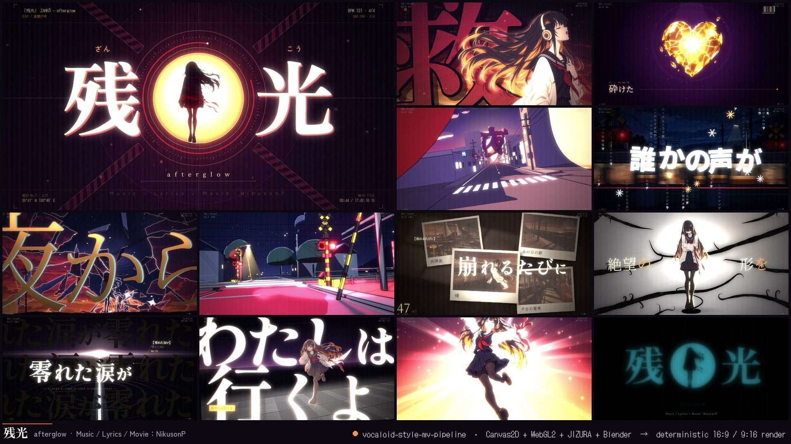
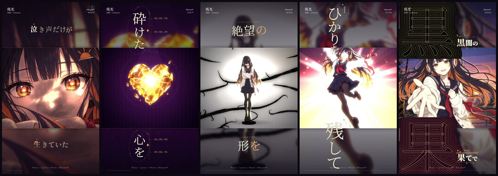
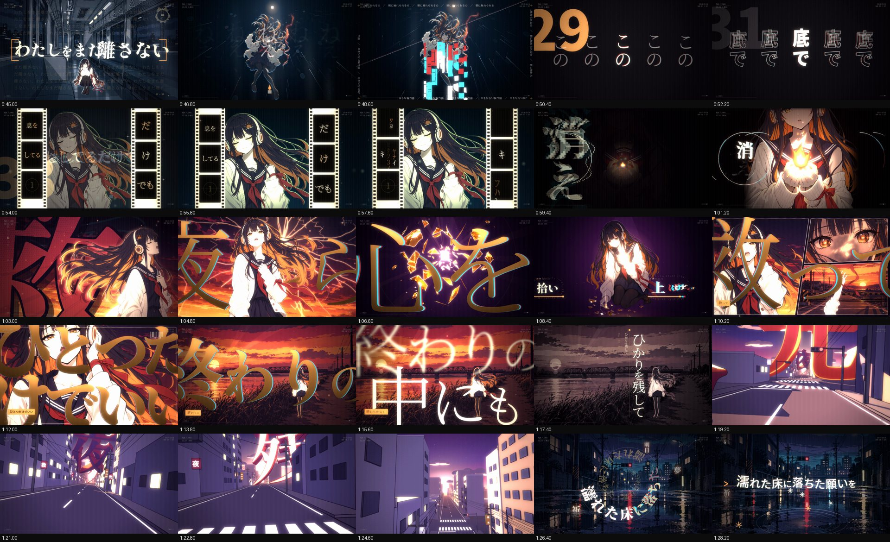
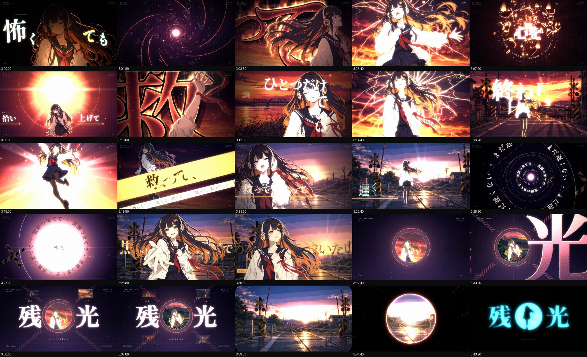
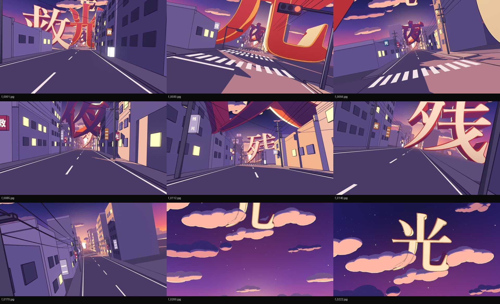
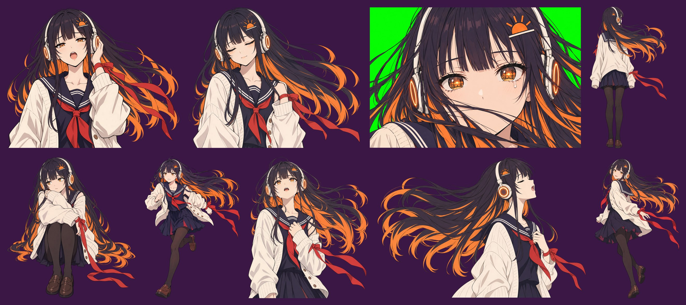
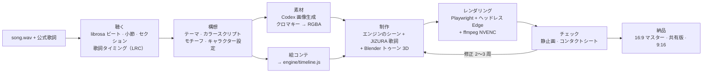

<p align="center">
  
</p>

<h1 align="center">Vocaloid-Style MV Pipeline</h1>

<p align="center"><code>vocaloid-style-mv-pipeline</code> · ボカロ風MV制作パイプライン</p>

<p align="center">
  <b>ボカロ系の手書き（tegaki）リリック MV やモーショングラフィックスのショーリールを作るための、Claude Code スキル＋プロジェクトテンプレート。<br>
  全フレームを決定論的なフロントエンドアニメーションエンジンで描画します。</b>
</p>

<p align="center">
  <a href="README.md">English</a> · <a href="README.zh-CN.md">简体中文</a> · 日本語
</p>

<p align="center">
  作者：<b>NikusonP</b> · MIT License · ショーケース：『残光』（Music / Lyrics / Movie：NikusonP）
</p>

---

## これは何か

AI エージェントに**曲と歌詞**を渡すと、ボカロ／V家手書き／文字PV の系譜に連なる、ショーリール品質のリリック MV を
最後まで作れるようにするキットです。出力は 1920×1080 のマスター、縦画面向けにネイティブに組み直した 1080×1920 の縦型版、
そして共有用エンコードです。

**これはフロントエンドアニメーションです。** すべてのフレームはヘッドレスブラウザの中で HTML **Canvas2D** が描き、
**WebGL2** が合成し、Playwright がキャプチャして ffmpeg がエンコードします。After Effects も編集ソフトも使いません。
各フレームは曲の時刻 `t` の純関数なので、映像そのものがコードです。何度レンダリングしても結果は同じで、
並列ワーカーはどのフレームからでも描画でき、エージェントは 4 分の MV のチェック・修正・再レンダリングを数分で回せます。

キットは二つの部分からなります。

- **スキル本体**（[`skills/vocaloid-style-mv/`](skills/vocaloid-style-mv/)）：`SKILL.md` と方法論のリファレンス群。
  エージェントを *聴く → 構想 → 素材 → 絵コンテ → 制作 → チェック → 納品* まで導きます。
- **プロジェクトテンプレート**（[`skills/vocaloid-style-mv/template/`](skills/vocaloid-style-mv/template/)）：
  エンジン、シーンライブラリ、[JIZURA 字面](https://github.com/852wa/JIZURA) によるリリックモーション層、
  音声解析と歌詞タイミングのツール、AI 画像生成ツール、Blender のトゥーン 3D ショットスクリプト、レンダラー。
  新しい MV プロジェクトはすべてこのテンプレートのコピーから始まります。

スキルは Claude Code 向けに書かれていますが、中身は Markdown とスクリプトだけなので、Codex など他のエージェントも同じ手順で使えます。

## ショーケース：『残光』

**『残光』（Zankō / "Afterglow"）。Music / Lyrics / Movie：NikusonP。**
オリジナルの V家系シンガー「灯（あかり）」が主人公の 3 分 46 秒の MV です。空がガラスのようにひび割れ、
彼女は夜へ落ちていき、小さな火を守り、砕けた心のかけらを拾い集め、最後は自分の涙でできた道を夜明けへ向かって歩いていきます。
全 68 カットがビートに同期し、JIZURA のタイポグラフィ、Blender によるトゥーン 3D シーケンス 2 本を使い、
曲がぴたりと止まる瞬間にシアンの残像へハードカットします。1080p30 の本編は **RTX 3080 で約 4 分**でレンダリングできます
（6,796 フレーム、3 ワーカー、約 31 fps）。

<p align="center">
  <br>
  <sub>9:16 版はクロップではなく再レイアウトです。JIZURA が縦画面に合わせて歌詞をすべてネイティブに組み直します。</sub>
</p>

<table>
  <tr>
    <td width="50%"><a href="examples/zanko/gallery/sheet_01.jpg"></a></td>
    <td width="50%"><a href="examples/zanko/gallery/sheet_04.jpg"></a></td>
  </tr>
  <tr>
    <td><a href="examples/zanko/gallery/blender_A.jpg"></a></td>
    <td><a href="examples/zanko/gallery/_core.jpg"></a></td>
  </tr>
</table>

ギャラリー（クリックで原寸表示）：

| 内容 | ファイル |
|---|---|
| 完成版レンダーのチェック用コンタクトシート（1.8 秒ごとに 1 フレーム） | [0:00–0:43](examples/zanko/gallery/sheet_00.jpg) · [0:45–1:28](examples/zanko/gallery/sheet_01.jpg) · [1:30–2:13](examples/zanko/gallery/sheet_02.jpg) · [2:15–2:58](examples/zanko/gallery/sheet_03.jpg) · [3:00–3:43](examples/zanko/gallery/sheet_04.jpg) · [エンドカード](examples/zanko/gallery/sheet_05.jpg) |
| 9:16 縦型版 | [前半](examples/zanko/gallery/vsheet_01.jpg) · [後半](examples/zanko/gallery/vsheet_02.jpg) |
| Blender トゥーン 3D | [A：夕暮れの漢字の街](examples/zanko/gallery/blender_A.jpg) · [B：夜の踏切](examples/zanko/gallery/blender_B.jpg) |
| タイポグラフィと色 | [JIZURA スタイル検証](examples/zanko/gallery/jizura_styles.jpg) · [パレットシステム](examples/zanko/gallery/style_palettes.png) |
| 生成素材 | [キャラクター原案候補](examples/zanko/gallery/_masters.jpg) · [ポーズ](examples/zanko/gallery/_core.jpg) · [追加ポーズ](examples/zanko/gallery/_more.jpg) · [物語用ポーズ](examples/zanko/gallery/_story_a.jpg) · [リテイク](examples/zanko/gallery/_fix.jpg) · [背景](examples/zanko/gallery/_bgs.jpg) · [夜の背景と小道具](examples/zanko/gallery/_story.jpg) |

ケーススタディ全体（ログライン、カラースクリプト、カット構成、見せ場とその作り方）は
[`examples/zanko/`](examples/zanko/README.md)（英語）にあります。

## 特長

- **決定論的レンダラー。** 各フレームは `t` の純関数です。ノイズはシード付き、パーティクルは閉形式で計算し、
  実時間には依存しません。複数のヘッドレスブラウザワーカーが任意のフレームへシークでき、分割レンダリングの継ぎ目も出ません。
- **レイヤー合成。** 1 フレームは四つの層でできています。シーン層（Canvas2D のイラスト、カメラ、パーティクル）、
  テキスト層（JIZURA の歌詞、独自タイポグラフィ、HUD）、*前景層*（歌詞の手前に描くキャラクター。文字が彼女の背後を通り抜けられます）、
  そして WebGL2 のポスト処理です。ポスト処理は 2コマ打ちのラインボイル（線のゆらぎ）、OKLab パレットのグラデーションマップ、
  ブルーム、色収差、グリッチ、ズームブラー、グレイン、フラッシュ、レターボックスを担当します。
  シーン専用のエフェクトは文字に触れないので、文字はいつもシャープなままです。
- **シーンライブラリ。** パラメータ化されたシーンを 24 種類収録しています：`illust`、`kanjiSlam`、`typeCard`、
  `titleRiff`、`ember`、`heart`、`skyShatter`、`fall`、`flame`、`ink`、`thread`、`wetFloor`、`train`、
  `memories`、`road`、`panels`、`burst`、`tunnel`、`converge`、`afterimage`、`ref`（別カットのフリーズ／巻き戻し／溶解）、
  `seq`（連番画像）、`jz`、`solid`。トランジションは 13 種類：cut、xfade、flash、black、iris、irisClose、barrier、
  wipe、slices、push、zoom、ink、shatter。どれも作り替えて使う道具箱であって、そのまま流用する絵柄ではありません。
- **JIZURA 字面のリリック層。** 上流のエンジンを無改変のまま決定論的なレイヤーとしてビルドします。1 本の映像で複数のプラン（スタイル）を使い分け、
  除外リストで厳選し、キャラクターカット用に中央を空けるレイアウトや、9:16 へのネイティブな再組版にも対応します。
- **ビート同期の編集。** `librosa` の解析でビート、ダウンビート、小節、セクション、ストップ、インパクト、フレームごとの
  エンベロープを取り出します。テンポの揺れにも対応しています。タイムラインのヘルパーが、すべてのカットを実際の小節頭やビートに合わせます。
- **歌詞タイミング。** 公式歌詞が最優先です。faster-whisper、ボーカル分離、強制アライメントはタイミング取得用、
  あるいは歌詞テキストがまったくない場合のためのものです。出力は JIZURA 記法（`/` カット区切り、`*強調*`、行末 `!` でキメ行）付きの LRC です。
- **オリジナルキャラクターと一貫した素材。** キャラクター設定 → 原案候補 → 原案を参照画像として全ポーズを生成 → グリーンバックを抜いて RGBA、
  という流れです。一括生成は Codex CLI で行い、他の画像生成モデルでも同じ方法が使えます。
- **トゥーン 3D。** Blender 5.x のショットスクリプトは EEVEE、Shader-to-RGB のセル影、Grease Pencil の線画を使い、
  1080p で 1 フレーム約 0.7 秒です。カメラはビートグリッドに合わせてキーを打ち、結果は連番画像としてエンジン内で同期再生します。
- **納品。** 16:9 マスター（NVENC CQ16 または x264）、共有用エンコード、9:16 の縦型再レイアウト、720p プレビューを出力します。
  チェック用ツール（静止画、コンタクトシート、N 秒ごとのレビューシート、JIZURA カット調査ツール）も付属します。

## パイプライン



1 フレームの中で起きていること：

```
 曲の時刻 t ─┬─► シーン層    Canvas2D 1920×1080：イラスト・カメラ・パーティクル ──┐
             ├─► テキスト層  JIZURA 字面 + 独自タイポ + HUD（透過） ──────────────┼─► WebGL2 ポスト ─► フレーム
             └─► 前景層      キャラクター（歌詞より手前） ────────────────────────┘   線のゆらぎ · パレット LUT · ブルーム
                                                                                      色収差 · グリッチ · グレイン · フラッシュ
```

## クイックスタート

**1. 環境チェック。**

```bash
python skills/vocaloid-style-mv/scripts/check_env.py
```

**2a. スキルをインストールする（おすすめ）。** Claude Code のスキルフォルダにコピーします。

```bash
# macOS / Linux / Git Bash
mkdir -p ~/.claude/skills && cp -r skills/vocaloid-style-mv ~/.claude/skills/
```
```powershell
# Windows PowerShell
New-Item -ItemType Directory -Force "$env:USERPROFILE\.claude\skills" | Out-Null
Copy-Item -Recurse -Force skills\vocaloid-style-mv "$env:USERPROFILE\.claude\skills\"
```

あとは曲と歌詞を入れたフォルダで Claude Code を開き、こう頼むだけです：

> この曲で V家手書き MV を作って（song.wav、lyrics.txt）

スキルはプロジェクトを作成し、曲を解析し、構想を提案して確認を求め、絵を生成し、映像を組んでレンダリングし、チェックまで行います。
途中、構想・キャラクター原案・最初の静止画・最初のフルレンダーの各段階で手を止めて確認します。

**2b. テンプレートを直接使う。**

```bash
python skills/vocaloid-style-mv/scripts/new_project.py ../my-mv --song path/to/song.wav --lyrics path/to/lyrics.lrc --setup
cd ../my-mv
```

`--setup` は Playwright と Python パッケージのインストール、フォントのダウンロード、JIZURA のクローンとビルドを行います。
`--title`、`--title-sub`、`--artist`、`--credit` を付けると、`engine/timeline.js` のタイトル、欧文サブタイトル、アーティスト名、クレジット行を設定できます。
あとは `../my-mv` でエージェントを開き、上と同じように頼んでください。スキルに対応していないエージェントには
`skills/vocaloid-style-mv/SKILL.md` を読ませれば大丈夫です。

まだ曲がない場合は、`--song` と `--lyrics` を省き、使い捨てのフォルダを指定してください（デモは自前の曲と歌詞をプロジェクトに書き込みます）。
新しいプロジェクトが、プロシージャルなデモ映像『蛍火』（24 秒、RTX 3080 でのレンダリングは約 30 秒）のコマンドを表示します。
マシンで最後までレンダリングできるかを確かめるスモークテストです。完成見本：
[16:9 動画](docs/images/demo_16x9.mp4) · [コンタクトシート](docs/images/demo_sheet.jpg) · [9:16 シート](docs/images/demo_vertical_sheet.jpg)。

<details>
<summary>エージェントが実行する主なコマンド（すべてプロジェクトのルートで実行）</summary>

```bash
python tools/analyze_audio.py                                   # audio/song.wav → analysis/audio.json（+ overview.png）
python tools/imagegen.py assets/char/jobs_core.jsonl --out-dir assets/char --concurrency 8
node tools/stills.mjs --times 12.5,62.6,130.8 --sheet check     # 静止画 + コンタクトシート → render/stills/
node tools/render_final.mjs --name mv                           # フルレンダー + 音声 mux → render/mv.mp4
python tools/review_sheets.py render/mv.mp4 --step 1.8 --out render/review1
```

全手順、受け入れ基準、時間の目安はスキルの [`references/01-workflow.md`](skills/vocaloid-style-mv/references/01-workflow.md) にあります。
`template/demo/` のプロシージャルなデモ曲は、新しいマシンでパイプラインが最後まで通るかを確かめるスモークテストに使えます。
デモ映像『蛍火』：[16:9 動画](docs/images/demo_16x9.mp4) · [コンタクトシート](docs/images/demo_sheet.jpg) · [9:16 シート](docs/images/demo_vertical_sheet.jpg)。

</details>

## 動作要件

| | 内容 | 備考 |
|---|---|---|
| **必須** | Node.js 20+ | Playwright、レンダリング・静止画スクリプト |
| **必須** | Python 3.10+ | `librosa`、`numpy`、`scipy`、`soundfile`、`pillow`、`matplotlib`（setup がインストール） |
| **必須** | ffmpeg + ffprobe（`PATH` 上） | エンコード、音声 mux、フレーム抽出 |
| **必須** | Microsoft Edge または Google Chrome | Playwright 経由のヘッドレス WebGL2（`msedge` / `chrome` チャンネル） |
| **必須** | git | setup で JIZURA をクローンするため |
| 任意 | NVIDIA GPU（NVENC） | GPU で WebGL を動かし、H.264 をハードウェアエンコード。ない場合は x264 にフォールバックし、ソフトウェア WebGL は約 10 倍遅い |
| 任意 | Blender 5.x | トゥーン 3D シーケンス。ない場合、エージェントは 3D の見せ場を 2.5D で組みます |
| 任意 | Codex CLI など画像生成ツール | キャラクターと背景の絵。どのモデルでも「参照画像＋クロマキー」の方法で使えます |
| 任意 | faster-whisper（+ CUDA） | 公式歌詞がないとき、またはタイミング合わせにだけ使用 |

動作確認済みのプラットフォームは Windows 11（PowerShell 5.1 または Git Bash）です。macOS と Linux はクロスプラットフォームのスクリプトで
対応していますが、検証はまだ少なめです。『残光』を RTX 3080 で作ったときの目安：音声解析 1 分弱、画像 1 枚 30〜110 秒（8〜10 枚並列）、
Blender 1 フレーム約 0.7 秒、1080p フルレンダー約 4 分。

setup は JIZURA を検証済みのコミット `fc16bfe` でクローンします。テンプレートの除外リストとスキーム番号は、このコミットで確認したものです。
別のバージョンを使うときは、setup 用に環境変数 `JIZURA_REF` でブランチ・タグ・コミット（40 桁の完全な SHA）を指定してください（上流に追従するなら `main`）。
`JIZURA_DIR` を設定すると setup は手元の既存クローンを使い、こちらが優先されます。

## リポジトリ構成

```
vocaloid-style-mv-pipeline/
├── README.md · README.zh-CN.md · README.ja.md
├── LICENSE · THIRD_PARTY_NOTICES.md
├── skills/
│   └── vocaloid-style-mv/              ← インストールするスキル（~/.claude/skills/ へコピー）
│       ├── SKILL.md                  ← 入口：フェーズ、原則、チェックポイント
│       ├── references/               ← 方法論：ワークフロー、クリエイティブディレクション、音声と歌詞、素材、
│       │                               エンジン、JIZURA、Blender、レンダリングと納品、QA と教訓
│       ├── scripts/                  ← new_project.py（プロジェクト作成）、check_env.py（環境チェック）
│       └── template/                 ← 新しい MV プロジェクトごとにコピーされる
│           ├── engine/               ← core/（util、assets、gl、draw、trans、main）、scenes/（ライブラリ）、
│           │                           index.html、vertical.html + vertical.js、fonts/
│           ├── jizura/app/           ← JIZURA アダプタ + ホストページ（バンドルは setup 時に vendor/JIZURA からビルド）
│           ├── tools/                ← 解析、歌詞タイミング、画像生成、静止画、レンダリング、レビューシート
│           ├── blender/              ← トゥーン 3D ショットスクリプト
│           ├── assets/               ← style/（パレット + LUT）、char/、bg/
│           ├── analysis/ · audio/    ← 曲ごとに中身を入れる
│           └── demo/                 ← プロシージャルなスモークテスト用の曲
├── examples/
│   └── zanko/                        ← 『残光』のケーススタディ：絵コンテ、タイムライン、プロンプト、ギャラリー
└── docs/images/                      ← README 用の画像
```

## 同じ完成度で、違う作品を

このキットが目指すのは『残光』の複製ではなく、**同じ完成度の別の作品**です。スキル全体を通して、次のような考え方があります。

- **構想は新しい曲から引き出す。** エージェントはまず*あなたの*歌詞と曲の構成を読みます。そこからテーマ（この曲が映像として何を語るのか）、
  カラースクリプト、基本図形とモチーフ、キャラクター、そして 6〜10 個の見せ場を見つけ、見せ場を曲の実際のサビ頭、ストップ、
  インストのキメに配置します。
- **シーンライブラリは道具箱。** ほとんどのカットは汎用の `illust`（背景・カメラ・キャラクター・エフェクト）です。特殊シーンが見せているのは
  *技法*、たとえば破砕、インクの侵食、ストロボするシルエット、連番再生、ビートごとの文字スラムです。新しい曲には新しいメタファーが必要なので、
  エージェントはこれらを作り替えるか、新しいシーンを書きます。
- **[`examples/zanko`](examples/zanko/README.md) はケーススタディであってプリセットではない。** 歌詞がどう絵になったか、セクションがどう
  盛り上がっていくかを学んでください。ひび割れた空、ガラスの心臓、リボン、パレットといったモチーフは、歌詞に出てこない曲には使わないでください。
  スキルのクリエイティブディレクション文書には*バリエーション表*（世界、時間の弧、パレット、図形、素材、線のスタイル、キャラクター、
  タイポの声、3D の役割、トランジション、エンディング）があります。新しいプランが 3 項目より多く『残光』と重なったら、エージェントはさらに遠ざけます。
- **夜も昼も。** テンプレートの初期値は『残光』の夕暮れと夜に合わせてあります。
  明るい昼の映像では、エージェントが最初の静止画の前に歌詞の配色、ポスト処理、パレットを調整し直します。
- **キャラクターはオリジナル。** 全ポーズを 1 枚の原案参照画像から生成します。既存キャラクターには絶対に似せません。
- **すべての結果を自分の目で見る。** 静止画とコンタクトシートをアートディレクターのつもりで見て、直して、再レンダリングします。
  品質の大部分はこのチェックのループから生まれます。

## クレジット

- **キット、『残光』の楽曲・歌詞・映像：** NikusonP。*Music / Lyrics / Movie：NikusonP*
- **[JIZURA 字面](https://github.com/852wa/JIZURA)**（852wa）：リリックモーションエンジン、MIT、© 2026 hakoniwa（setup 時に取得、リポジトリには同梱しません）
- **フォント：** Google Fonts のファミリー（Noto Sans/Serif JP & SC、Zen Old Mincho、Zen Kaku Gothic New、Shippori Mincho B1、
  Kaisei Tokumin、Klee One、Yuji Syuku、DotGothic16、Dela Gothic One、Rampart One、Reggae One、M PLUS Rounded 1c）、SIL OFL 1.1
- **[Playwright](https://playwright.dev/)**（Apache-2.0）· **[librosa](https://librosa.org/)**（ISC）·
  **NumPy / SciPy**（BSD-3-Clause）· **Pillow**（MIT-CMU）· **soundfile**（BSD-3-Clause）·
  **[faster-whisper](https://github.com/SYSTRAN/faster-whisper)**（MIT）· **CTranslate2**（MIT）·
  **ONNX Runtime**（MIT）
- **外部ツール：** [Blender](https://www.blender.org/)（GPL）、[FFmpeg](https://ffmpeg.org/)（LGPL/GPL）、
  [Codex CLI](https://github.com/openai/codex)（イラストは AI 画像モデルで生成）、Microsoft Edge
- [Claude Code](https://claude.com/claude-code) で制作。

任意のモデルとその利用条件を含む詳細は [`THIRD_PARTY_NOTICES.md`](THIRD_PARTY_NOTICES.md) を参照してください。

## ライセンス

キットのコード、スキル、ドキュメントは [MIT License](LICENSE) で公開しています。© 2026 NikusonP。

楽曲『残光』、その歌詞、キャラクター「灯」、そして `examples/zanko/` と `docs/images/` にある MV のフレームは NikusonP の作品です（© 2026 NikusonP、無断転用禁止。MIT License の**対象外**です）。
ケーススタディとしてのみ収録しています。**楽曲の音声と原寸の美術素材はこのリポジトリに含まれていません。**
『残光』の素材を自分の MV の素材として使うのはご遠慮ください。あなたの曲から、あなたの曲のための作品を作ってください。それがこのキットの目的です。
サードパーティのコンポーネントはそれぞれのライセンスに従います。詳しくは [`THIRD_PARTY_NOTICES.md`](THIRD_PARTY_NOTICES.md) を参照してください。

**商標について：** VOCALOID（ボーカロイド）はヤマハ株式会社の登録商標です。本プロジェクトは独立した制作物であり、ヤマハ株式会社とは提携・協賛・承認の関係にありません。「Vocaloid-style」はファンメイドの音楽動画（ボカロMV）の映像ジャンルを表す記述的な表現です。

---

<p align="center">作者：<b>NikusonP</b></p>
