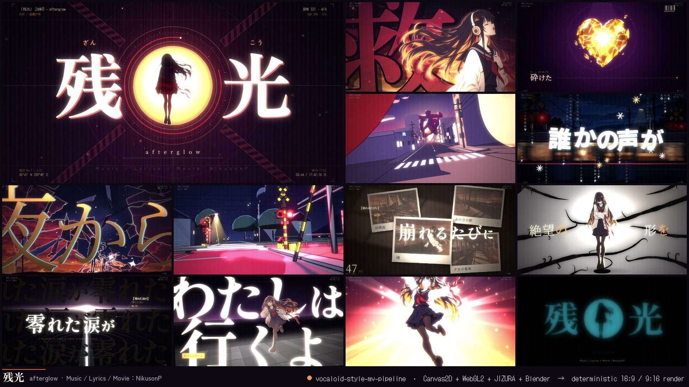
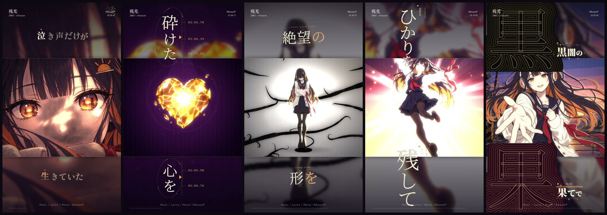
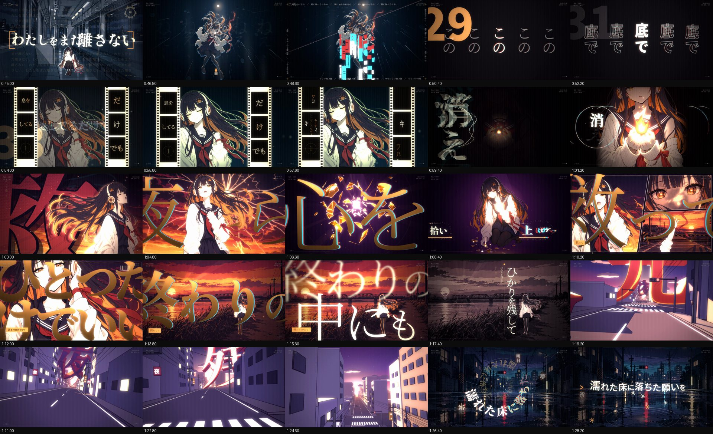
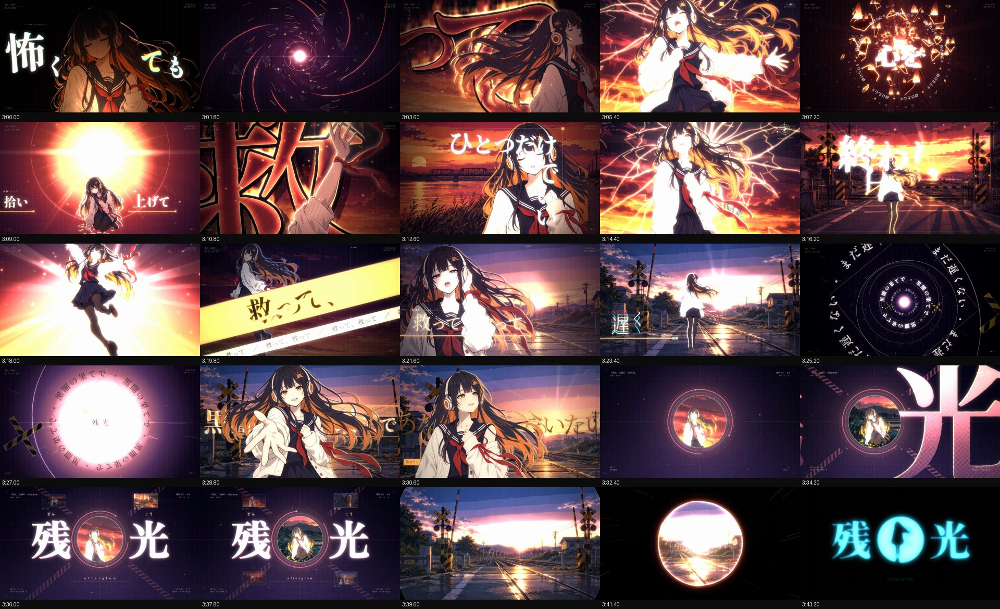
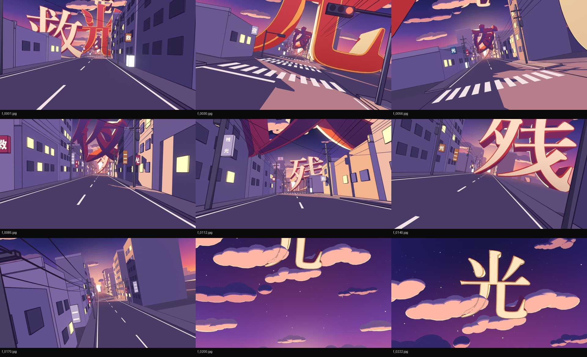
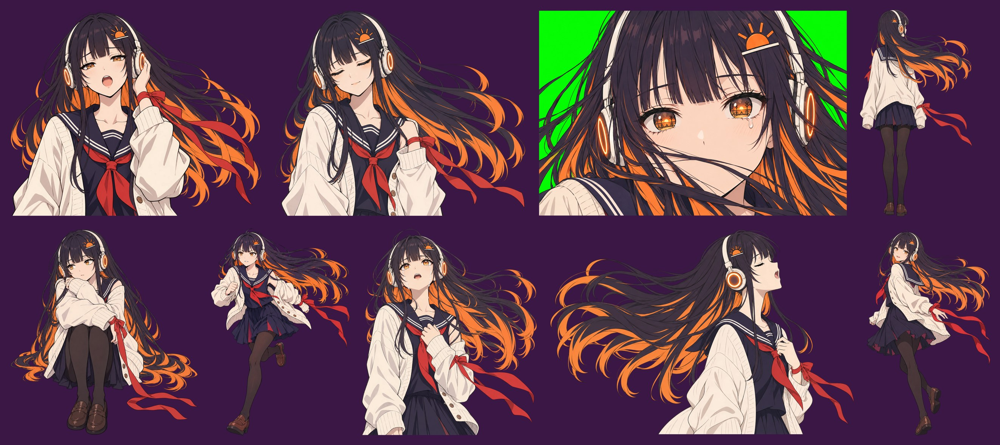
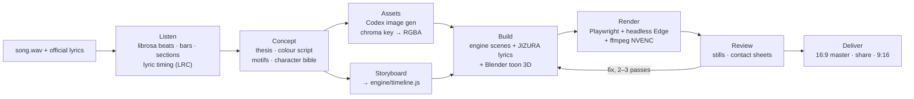

<p align="center">
  
</p>

<h1 align="center">Vocaloid-Style MV Pipeline</h1>

<p align="center"><code>vocaloid-style-mv-pipeline</code></p>

<p align="center">
  <b>A Claude Code skill and project template for Vocaloid-style 手書き (tegaki) lyric MVs and motion-graphics showreels.<br>
  A deterministic front-end animation engine renders every frame.</b>
</p>

<p align="center">
  English · <a href="README.zh-CN.md">简体中文</a> · <a href="README.ja.md">日本語</a>
</p>

<p align="center">
  Author: <b>NikusonP</b> · MIT License · showcase: 「残光」 (Music / Lyrics / Movie：NikusonP)
</p>

---

## What it is

Give an AI agent **a song and its lyrics**, and this kit lets it produce a finished, showreel-quality lyric music
video in the ボカロ / V家手书 / 文字PV tradition. You get a 1920×1080 master, a natively re-laid-out 1080×1920
vertical version, and share encodes.

**It is front-end animation.** Every frame is drawn by HTML **Canvas2D** and composited by **WebGL2** in a
headless browser. Playwright captures the frames and ffmpeg encodes them. No After Effects, no timeline editor.
A frame is a pure function of song time `t`, so the film is code: re-rendering always gives the same result,
parallel workers can render any frame, and an agent can review, fix and re-render a 4-minute MV in minutes.

The kit has two parts:

- **The skill** ([`skills/vocaloid-style-mv/`](skills/vocaloid-style-mv/)): `SKILL.md` plus method references that
  take an agent from *listen → concept → assets → storyboard → build → review → deliver*.
- **The project template** ([`skills/vocaloid-style-mv/template/`](skills/vocaloid-style-mv/template/)): the engine,
  a scene library, the [JIZURA 字面](https://github.com/852wa/JIZURA) lyric-motion layer, audio-analysis and
  lyric-timing tools, AI image-generation tooling, Blender toon-3D shot scripts and the renderer. Every new MV
  project starts as a copy of it.

The skill was written for Claude Code, but it is plain Markdown plus scripts, so other agents such as Codex
can follow it too.

## Showcase: 「残光」

**「残光」 (Zankō, "Afterglow"). Music / Lyrics / Movie：NikusonP.**
A 3:46 MV with an original V家-style singer, 灯 (Akari). The sky cracks like glass, she falls into the night,
keeps a small flame alive, gathers the pieces of her shattered heart, and walks a road made of her own tears
toward the dawn. It has 68 beat-locked shots, JIZURA typography, two Blender toon-3D sequences, and a hard cut
on the song's dead stop to a cyan afterimage. The full 1080p30 film renders in **≈4 minutes on an RTX 3080**
(6,796 frames, 3 workers, ≈31 fps).

<p align="center">
  <br>
  <sub>The 9:16 version is a re-layout, not a crop: JIZURA re-typesets every lyric natively for the tall frame.</sub>
</p>

<table>
  <tr>
    <td width="50%"><a href="examples/zanko/gallery/sheet_01.jpg"></a></td>
    <td width="50%"><a href="examples/zanko/gallery/sheet_04.jpg"></a></td>
  </tr>
  <tr>
    <td><a href="examples/zanko/gallery/blender_A.jpg"></a></td>
    <td><a href="examples/zanko/gallery/_core.jpg"></a></td>
  </tr>
</table>

More in the gallery (click to open full size):

| what | files |
|---|---|
| Review contact sheets of the final render, one frame every 1.8 s | [0:00–0:43](examples/zanko/gallery/sheet_00.jpg) · [0:45–1:28](examples/zanko/gallery/sheet_01.jpg) · [1:30–2:13](examples/zanko/gallery/sheet_02.jpg) · [2:15–2:58](examples/zanko/gallery/sheet_03.jpg) · [3:00–3:43](examples/zanko/gallery/sheet_04.jpg) · [end card](examples/zanko/gallery/sheet_05.jpg) |
| 9:16 vertical version | [part 1](examples/zanko/gallery/vsheet_01.jpg) · [part 2](examples/zanko/gallery/vsheet_02.jpg) |
| Blender toon 3D | [A: dusk street of kanji](examples/zanko/gallery/blender_A.jpg) · [B: night railway crossing](examples/zanko/gallery/blender_B.jpg) |
| Typography and colour | [JIZURA style probe](examples/zanko/gallery/jizura_styles.jpg) · [palette system](examples/zanko/gallery/style_palettes.png) |
| Generated assets | [character masters](examples/zanko/gallery/_masters.jpg) · [poses](examples/zanko/gallery/_core.jpg) · [more poses](examples/zanko/gallery/_more.jpg) · [story poses](examples/zanko/gallery/_story_a.jpg) · [fixes](examples/zanko/gallery/_fix.jpg) · [backgrounds](examples/zanko/gallery/_bgs.jpg) · [night backgrounds + props](examples/zanko/gallery/_story.jpg) |

The full case study (logline, colour script, shot structure, signature moments and how each was built) is in
[`examples/zanko/`](examples/zanko/README.md).

## Features

- **Deterministic renderer.** Each frame is a pure function of `t`: seeded noise, closed-form particles, no
  wall-clock time. Parallel headless-browser workers seek arbitrary frames, and the segments join without seams.
- **Layered compositing.** Each frame has a scene layer (Canvas2D illustration, camera, particles), a text layer
  (JIZURA lyrics, custom typography, HUD), a *foreground* layer (the character drawn in front of the lyrics, so
  text can pass behind her), and a WebGL2 post pass. The post pass does line boil on 2s, OKLab palette gradient
  maps, bloom, chromatic aberration, glitch, zoom blur, grain, flashes and letterbox. Text stays crisp because the
  scene-only effects never touch it.
- **Scene library.** 24 parameterised scenes are included: `illust`, `kanjiSlam`, `typeCard`, `titleRiff`,
  `ember`, `heart`, `skyShatter`, `fall`, `flame`, `ink`, `thread`, `wetFloor`, `train`, `memories`, `road`,
  `panels`, `burst`, `tunnel`, `converge`, `afterimage`, `ref` (freeze / rewind / melt another shot), `seq`
  (image sequences), `jz`, `solid`. There are also 13 transitions: cut, xfade, flash, black, iris, irisClose,
  barrier, wipe, slices, push, zoom, ink, shatter. All of them are a toolbox to adapt, not a look to reuse.
- **JIZURA 字面 lyric layer.** The upstream engine is built unmodified into a deterministic layer, with several
  plans (styles) per film, curated deny-lists, centre-free layouts for character shots, and native 9:16
  re-typesetting.
- **A beat-locked edit.** `librosa` analysis gives beats, downbeats, bars, sections, stops, impacts and per-frame
  envelopes, and it handles tempo drift. Timeline helpers snap every cut to a real bar or beat.
- **Lyric timing.** Official lyrics come first. faster-whisper, vocal-stem separation and forced alignment are
  there for timings, or for the case where no text exists. The output is an LRC file with JIZURA markup
  (`/` cut, `*emphasis*`, `!` キメ line).
- **An original character and consistent assets.** The pipeline goes character bible → master candidates →
  every pose generated with the master as a reference image → chroma key to RGBA. Batch generation runs through
  the Codex CLI, and any image model works with the same method.
- **Toon 3D.** The Blender 5.x shot scripts use EEVEE, Shader-to-RGB cel shading and Grease Pencil line art, at
  about 0.7 s per 1080p frame. Cameras are keyed to the beat grid, and the result plays back in the engine as an
  image sequence.
- **Delivery.** You get a 16:9 master (NVENC CQ16 or x264), a share encode, a 9:16 vertical re-layout and 720p
  previews, plus review tools: stills, contact sheets, review sheets every N seconds, and a JIZURA cut inspector.

## Pipeline



What happens inside one frame:

```
 song time t ─┬─► scene layer       Canvas2D 1920×1080: illustration, camera, particles ──┐
              ├─► text layer        JIZURA 字面 + custom typography + HUD (transparent) ──┼─► WebGL2 post ─► frame
              └─► foreground layer  the character, in front of the lyrics ────────────────┘   line boil · palette LUT · bloom
                                                                                              CA · glitch · grain · flash
```

## Quick start

**1. Check the machine.**

```bash
python skills/vocaloid-style-mv/scripts/check_env.py
```

**2a. Install the skill (recommended).** Copy it to your Claude Code skills folder:

```bash
# macOS / Linux / Git Bash
mkdir -p ~/.claude/skills && cp -r skills/vocaloid-style-mv ~/.claude/skills/
```
```powershell
# Windows PowerShell
New-Item -ItemType Directory -Force "$env:USERPROFILE\.claude\skills" | Out-Null
Copy-Item -Recurse -Force skills\vocaloid-style-mv "$env:USERPROFILE\.claude\skills\"
```

Then put your song and lyrics in a folder, open Claude Code there and ask:

> make a V家手書き MV for this song (song.wav, lyrics.txt)

The skill scaffolds a project, analyses the song, proposes a concept for you to check, generates the art, builds
and renders the film, and reviews it. It stops at a few checkpoints along the way: the concept, the character
master, the first stills and the first full render.

**2b. Or use the template directly.**

```bash
python skills/vocaloid-style-mv/scripts/new_project.py ../my-mv --song path/to/song.wav --lyrics path/to/lyrics.lrc --setup
cd ../my-mv
```

`--setup` installs Playwright and the Python packages, downloads the fonts, and clones and builds JIZURA.
`--title`, `--title-sub`, `--artist` and `--credit` set the film's title, Latin subtitle, artist name and credit
line in `engine/timeline.js`. Open your agent in `../my-mv` and ask for the MV as above. Agents without skill
support can be pointed at `skills/vocaloid-style-mv/SKILL.md`.

No song yet? Leave out `--song` / `--lyrics` and use a throwaway folder (the demo writes its own song and lyrics
into the project). The new project then prints the commands for the procedural demo film 「蛍火」 (24 s; about
30 s to render on an RTX 3080), a smoke test that the machine renders end to end. Expected result:
[16:9 clip](docs/images/demo_16x9.mp4) · [contact sheet](docs/images/demo_sheet.jpg) ·
[9:16 sheet](docs/images/demo_vertical_sheet.jpg).

<details>
<summary>The main commands the agent runs (all from the project root)</summary>

```bash
python tools/analyze_audio.py                                   # audio/song.wav → analysis/audio.json (+ overview.png)
python tools/imagegen.py assets/char/jobs_core.jsonl --out-dir assets/char --concurrency 8
node tools/stills.mjs --times 12.5,62.6,130.8 --sheet check     # stills + contact sheet → render/stills/
node tools/render_final.mjs --name mv                           # full render + audio mux → render/mv.mp4
python tools/review_sheets.py render/mv.mp4 --step 1.8 --out render/review1
```

The skill's [`references/01-workflow.md`](skills/vocaloid-style-mv/references/01-workflow.md) has the full
sequence, acceptance criteria and time budget. A procedural demo song in `template/demo/` is a smoke test that
proves a new machine renders end to end. Its film, 「蛍火」: [16:9 clip](docs/images/demo_16x9.mp4) ·
[contact sheet](docs/images/demo_sheet.jpg) · [9:16 sheet](docs/images/demo_vertical_sheet.jpg).

</details>

## Requirements

| | what | notes |
|---|---|---|
| **required** | Node.js 20+ | Playwright, the render and stills scripts |
| **required** | Python 3.10+ | `librosa`, `numpy`, `scipy`, `soundfile`, `pillow`, `matplotlib` (setup installs them) |
| **required** | ffmpeg + ffprobe on `PATH` | encoding, audio mux, frame extraction |
| **required** | Microsoft Edge or Google Chrome | headless WebGL2 through Playwright (`msedge` / `chrome` channel) |
| **required** | git | setup clones JIZURA |
| optional | NVIDIA GPU (NVENC) | GPU WebGL plus hardware H.264. Without it, encoding falls back to x264, and software WebGL is about 10× slower |
| optional | Blender 5.x | toon 3D sequences. Without it, the agent stages the 3D moments in 2.5D |
| optional | Codex CLI, or another image generator | character and background art. Any model works with the reference-image + chroma-key method |
| optional | faster-whisper (+ CUDA) | only when no official lyrics exist, or to align timings |

Windows 11 (PowerShell 5.1 or Git Bash) is the tested platform. macOS and Linux are supported through the
cross-platform scripts but have seen less testing. Reference numbers from 「残光」 on an RTX 3080: audio analysis
under 1 min; one generated image 30–110 s (8–10 in parallel); Blender ≈0.7 s/frame; full 1080p render ≈4 min.

Setup clones JIZURA at the tested commit `fc16bfe`; the template's deny-lists and scheme indices are checked
against it. To use another version, set the environment variable `JIZURA_REF` to a branch, tag or full commit
sha for setup (e.g. `main` to follow upstream). `JIZURA_DIR` points setup at an existing local clone and takes precedence.

## Repository layout

```
vocaloid-style-mv-pipeline/
├── README.md · README.zh-CN.md · README.ja.md
├── LICENSE · THIRD_PARTY_NOTICES.md
├── skills/
│   └── vocaloid-style-mv/              ← the installable skill (copy to ~/.claude/skills/)
│       ├── SKILL.md                  ← entry point: phases, principles, checkpoints
│       ├── references/               ← method: workflow, creative direction, audio & lyrics, assets,
│       │                               engine, JIZURA, Blender, render & delivery, QA & lessons
│       ├── scripts/                  ← new_project.py (scaffold), check_env.py (environment check)
│       └── template/                 ← copied into every new MV project
│           ├── engine/               ← core/ (util, assets, gl, draw, trans, main), scenes/ (library),
│           │                           index.html, vertical.html + vertical.js, fonts/
│           ├── jizura/app/           ← JIZURA adapter + host pages (bundle built at setup from vendor/JIZURA)
│           ├── tools/                ← analysis, lyric timing, image gen, stills, render, review sheets
│           ├── blender/              ← toon 3D shot scripts
│           ├── assets/               ← style/ (palettes + LUTs), char/, bg/
│           ├── analysis/ · audio/    ← filled per song
│           └── demo/                 ← procedural smoke-test song
├── examples/
│   └── zanko/                        ← 「残光」 case study: storyboard, timeline, prompts, gallery
└── docs/images/                      ← README images
```

## Similar craft, different film

The kit aims for **another film of the same quality**, not a 残光 clone. A few ideas carry through the skill:

- **The concept comes from the new song.** The agent reads *your* lyrics and structure first. From them it
  finds a thesis (what the song is about visually), a colour script, master shapes and motifs, a character, and
  6–10 signature moments placed on the song's real chorus downbeats, stops and instrumental hits.
- **The scene library is a toolbox.** Most shots are generic `illust` shots (background, camera, character,
  effects). The special scenes show *techniques* such as shatter, ink growth, strobing silhouettes, image-sequence
  playback and per-beat slams. A new song needs new metaphors, so the agent adapts these scenes or writes new ones.
- **[`examples/zanko`](examples/zanko/README.md) is a case study, not a preset.** Learn how a lyric became an
  image and how a section built up. Do not reuse its cracked sky, glass heart, ribbon or palettes for a song that
  never mentions them. The skill's creative-direction reference has a *variation matrix* (world, time arc,
  palette, shape, material, line style, character, typography, 3D role, transitions, ending). If a new plan
  matches 残光 on more than three axes, the agent pushes further.
- **Night or daylight.** The template's defaults are tuned for 残光's dusk and night; for a bright, daytime film
  the agent re-tunes the lyric colours, the post look and the palettes before the first still.
- **The character is original.** Every pose is generated from one master reference. Existing characters are
  never imitated.
- **Look at every result.** Stills and contact sheets get reviewed like an art director would, then fixed and
  re-rendered. Most of the quality comes from this review loop.

## Credits

- **Kit, 「残光」 song, lyrics and movie:** NikusonP. *Music / Lyrics / Movie：NikusonP*
- **[JIZURA 字面](https://github.com/852wa/JIZURA)** by 852wa: lyric-motion engine, MIT, © 2026 hakoniwa (fetched at setup, not vendored)
- **Fonts:** Google Fonts families (Noto Sans/Serif JP & SC, Zen Old Mincho, Zen Kaku Gothic New, Shippori
  Mincho B1, Kaisei Tokumin, Klee One, Yuji Syuku, DotGothic16, Dela Gothic One, Rampart One, Reggae One, M PLUS
  Rounded 1c), SIL OFL 1.1
- **[Playwright](https://playwright.dev/)** (Apache-2.0) · **[librosa](https://librosa.org/)** (ISC) ·
  **NumPy / SciPy** (BSD-3-Clause) · **Pillow** (MIT-CMU) · **soundfile** (BSD-3-Clause) ·
  **[faster-whisper](https://github.com/SYSTRAN/faster-whisper)** (MIT) · **CTranslate2** (MIT) ·
  **ONNX Runtime** (MIT)
- **External tools:** [Blender](https://www.blender.org/) (GPL), [FFmpeg](https://ffmpeg.org/) (LGPL/GPL),
  [Codex CLI](https://github.com/openai/codex) (illustrations generated with an AI image model), Microsoft Edge
- Built with [Claude Code](https://claude.com/claude-code).

Full details, including the optional models and their terms: [`THIRD_PARTY_NOTICES.md`](THIRD_PARTY_NOTICES.md).

## License

The kit's code, skill and documentation are released under the [MIT License](LICENSE), © 2026 NikusonP.

The song 「残光」, its lyrics, the character 灯 and the MV frames in `examples/zanko/` and `docs/images/` are
© 2026 NikusonP, all rights reserved — they are **not** covered by the MIT License and are included only as a case study. **The song audio and the full-resolution artwork are not
in this repository.** Please don't reuse the 残光 material as the material of your own MV. Make your own from
your song; that is what the kit is for. Third-party components keep their own licences; see
[`THIRD_PARTY_NOTICES.md`](THIRD_PARTY_NOTICES.md).

**Trademark notice.** VOCALOID is a registered trademark of Yamaha Corporation. This is an independent project, not affiliated with, sponsored or endorsed by Yamaha Corporation; "Vocaloid-style" describes the visual genre of fan-made music videos (ボカロMV / V家手书).

---

<p align="center">Author: <b>NikusonP</b></p>
