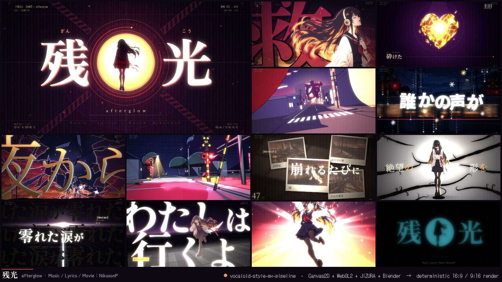
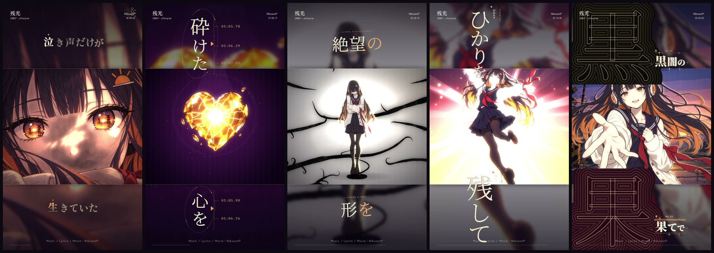
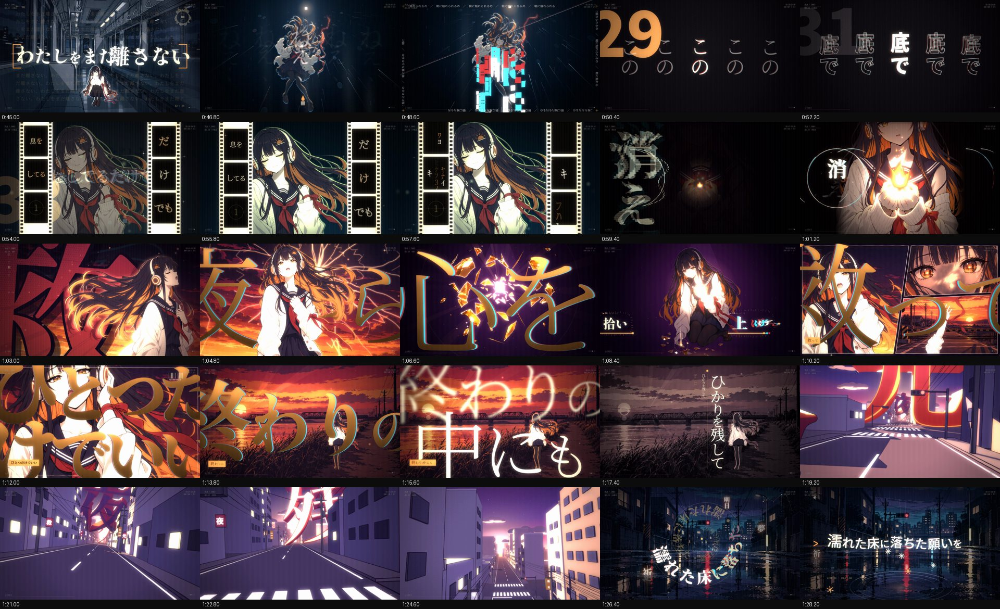
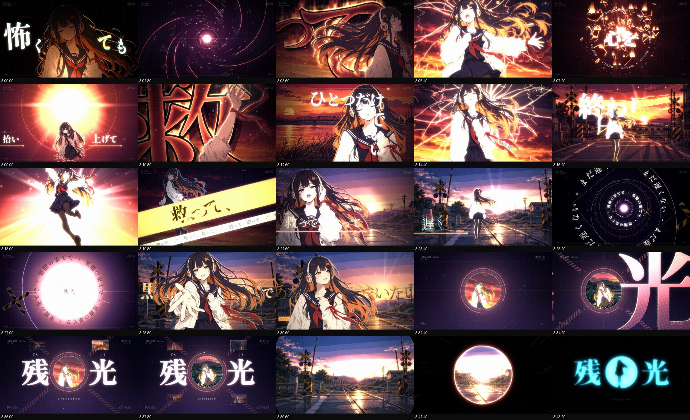
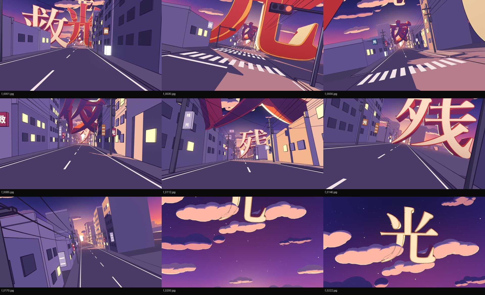
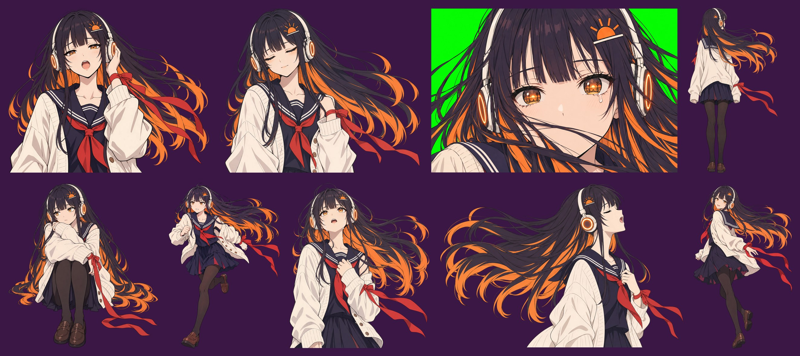
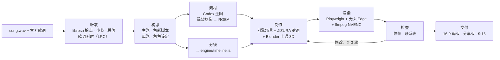

<p align="center">
  
</p>

<h1 align="center">Vocaloid-Style MV Pipeline</h1>

<p align="center"><code>vocaloid-style-mv-pipeline</code> · V家风格 MV 制作管线</p>

<p align="center">
  <b>用于制作 V 家手书风（手書き / tegaki）歌词 MV 和动态图形作品集的 Claude Code 技能（skill）＋ 项目模板。<br>
  每一帧都由一个确定性的前端动画引擎渲染。</b>
</p>

<p align="center">
  <a href="README.md">English</a> · 简体中文 · <a href="README.ja.md">日本語</a>
</p>

<p align="center">
  作者：<b>NikusonP</b> · MIT 许可证 · 示例作品：《残光》（Music / Lyrics / Movie：NikusonP）
</p>

---

## 这是什么

把**一首歌和它的歌词**交给 AI 智能体，借助这套工具，它就能做出一支达到作品集水准的完整歌词 MV，风格属于
ボカロ / V 家手书 / 文字 PV 一脉。产出包括 1920×1080 母版、按竖屏原生重新排版的 1080×1920 竖版，以及用于分享的压制版本。

**是的，这就是前端动画。** 每一帧都在无头浏览器里由 HTML **Canvas2D** 绘制、再由 **WebGL2** 合成，
Playwright 逐帧截取，ffmpeg 编码。不用 After Effects，也不用剪辑软件。
每一帧都是歌曲时间 `t` 的纯函数，所以整部片子就是代码：重新渲染的结果总是一样，多个并行进程可以渲染任意一帧，
智能体也能在几分钟内完成一支 4 分钟 MV 的检查、修改和重渲染。

本仓库包含两部分：

- **技能本体**（[`skills/vocaloid-style-mv/`](skills/vocaloid-style-mv/)）：`SKILL.md` 加上一组方法论参考文档，
  带智能体走完 *听歌 → 构思 → 素材 → 分镜 → 制作 → 检查 → 交付* 的全过程。
- **项目模板**（[`skills/vocaloid-style-mv/template/`](skills/vocaloid-style-mv/template/)）：包括引擎、场景库、
  [JIZURA 字面](https://github.com/852wa/JIZURA) 歌词动效层、音频分析与歌词对时工具、AI 生图工具、
  Blender 卡通渲染 3D 镜头脚本和渲染器。每个新 MV 项目都从复制这份模板开始。

这个技能是为 Claude Code 写的，但内容只是 Markdown 加脚本，Codex 等其他智能体同样可以照着执行。

## 作品展示：《残光》

**《残光》（Zankō / "Afterglow"）。Music / Lyrics / Movie：NikusonP。**
一支 3 分 46 秒的 MV，主角是原创的 V 家风歌手「灯（Akari）」。天空像玻璃一样裂开，她坠入黑夜，守着一小簇火苗，
拾起心碎的碎片，最后踏着自己泪水铺成的路走向黎明。全片 68 个镜头都卡在节拍上，配合 JIZURA 字效、两段 Blender
卡通 3D 段落，并在歌曲戛然而止的那一刻硬切到青色的残像。整部 1080p30 成片在 **RTX 3080 上约 4 分钟渲染完成**
（6,796 帧，3 个并行进程，约 31 fps）。

<p align="center">
  <br>
  <sub>9:16 竖版是重新排版，而不是裁切：JIZURA 会针对竖屏原生地重新排每一句歌词。</sub>
</p>

<table>
  <tr>
    <td width="50%"><a href="examples/zanko/gallery/sheet_01.jpg"></a></td>
    <td width="50%"><a href="examples/zanko/gallery/sheet_04.jpg"></a></td>
  </tr>
  <tr>
    <td><a href="examples/zanko/gallery/blender_A.jpg"></a></td>
    <td><a href="examples/zanko/gallery/_core.jpg"></a></td>
  </tr>
</table>

更多图（点击查看原尺寸）：

| 内容 | 文件 |
|---|---|
| 成片检查用联系表，每 1.8 秒取一帧 | [0:00–0:43](examples/zanko/gallery/sheet_00.jpg) · [0:45–1:28](examples/zanko/gallery/sheet_01.jpg) · [1:30–2:13](examples/zanko/gallery/sheet_02.jpg) · [2:15–2:58](examples/zanko/gallery/sheet_03.jpg) · [3:00–3:43](examples/zanko/gallery/sheet_04.jpg) · [片尾卡](examples/zanko/gallery/sheet_05.jpg) |
| 9:16 竖版 | [第 1 部分](examples/zanko/gallery/vsheet_01.jpg) · [第 2 部分](examples/zanko/gallery/vsheet_02.jpg) |
| Blender 卡通 3D | [A：黄昏的汉字街道](examples/zanko/gallery/blender_A.jpg) · [B：夜晚的铁道道口](examples/zanko/gallery/blender_B.jpg) |
| 字效与色彩 | [JIZURA 风格测试](examples/zanko/gallery/jizura_styles.jpg) · [调色板系统](examples/zanko/gallery/style_palettes.png) |
| 生成的素材 | [角色定稿候选](examples/zanko/gallery/_masters.jpg) · [姿势](examples/zanko/gallery/_core.jpg) · [更多姿势](examples/zanko/gallery/_more.jpg) · [剧情姿势](examples/zanko/gallery/_story_a.jpg) · [返工](examples/zanko/gallery/_fix.jpg) · [背景](examples/zanko/gallery/_bgs.jpg) · [夜景背景与道具](examples/zanko/gallery/_story.jpg) |

完整的案例分析（一句话梗概、色彩脚本、镜头结构、高光时刻及其做法）见
[`examples/zanko/`](examples/zanko/README.md)（英文）。

## 功能特性

- **确定性渲染器。** 每一帧都是 `t` 的纯函数：噪声带种子，粒子用解析式计算，不读系统时钟。多个无头浏览器进程
  可以跳到任意一帧渲染，分段拼接没有接缝。
- **分层合成。** 每一帧分四层：场景层（Canvas2D 插画、镜头运动、粒子）、文字层（JIZURA 歌词、自定义字效、HUD）、
  *前景层*（画在歌词前面的角色，于是文字可以从她身后穿过），以及 WebGL2 后期。后期负责一拍二的线条抖动、
  OKLab 调色板渐变映射、辉光、色差、故障、径向模糊、颗粒、闪白和遮幅。只作用于场景的效果不会碰到文字，所以文字始终清晰。
- **场景库。** 内置 24 个参数化场景：`illust`、`kanjiSlam`、`typeCard`、`titleRiff`、`ember`、`heart`、
  `skyShatter`、`fall`、`flame`、`ink`、`thread`、`wetFloor`、`train`、`memories`、`road`、`panels`、
  `burst`、`tunnel`、`converge`、`afterimage`、`ref`（对另一个镜头做定格 / 倒带 / 融化）、`seq`（图像序列）、
  `jz`、`solid`。另有 13 种转场：cut、xfade、flash、black、iris、irisClose、barrier、wipe、slices、push、
  zoom、ink、shatter。这些都是用来改造的工具箱，而不是拿来照搬的画风。
- **JIZURA 字面歌词层。** 上游引擎原样构建成一个确定性的图层；一部片子可以用多套方案（风格），配合筛选黑名单、
  为人物镜头留出画面中央的版式，以及原生的 9:16 重新排版。
- **卡拍剪辑。** `librosa` 分析出拍点、强拍、小节、段落、停顿、冲击点和逐帧包络，也能处理速度漂移。
  时间线辅助函数让每一刀都落在真实的小节或拍点上。
- **歌词对时。** 优先使用官方歌词。faster-whisper、人声分离和强制对齐只用来取时间轴，或者在完全没有歌词文本时使用。
  产出是带 JIZURA 标记的 LRC 文件（`/` 切分、`*强调*`、行尾 `!` 表示キメ句）。
- **原创角色与统一的素材。** 流程是：角色设定 → 定稿候选 → 以定稿图作参考图生成所有姿势 → 绿幕抠成 RGBA。
  批量生成通过 Codex CLI 完成，换成任何生图模型也能用同一套方法。
- **卡通 3D。** Blender 5.x 镜头脚本使用 EEVEE、Shader-to-RGB 赛璐珞着色和 Grease Pencil 线稿，
  1080p 约 0.7 秒一帧。镜头运动按节拍网格打关键帧，结果作为图像序列在引擎里同步播放。
- **交付。** 产出 16:9 母版（NVENC CQ16 或 x264）、分享用压制版、9:16 竖版重排和 720p 预览，另附检查工具：
  静帧、联系表、每隔 N 秒一张的检查表，以及 JIZURA 切分查看器。

## 流程



一帧之内发生的事：

```
 歌曲时间 t ─┬─► 场景层  Canvas2D 1920×1080：插画、镜头、粒子 ────┐
             ├─► 文字层  JIZURA 字面 + 自定义字效 + HUD（透明） ──┼─► WebGL2 后期 ─► 输出帧
             └─► 前景层  角色，画在歌词之前 ──────────────────────┘   线条抖动 · 调色 LUT · 辉光
                                                                      色差 · 故障 · 颗粒 · 闪白
```

## 快速上手

**1. 检查环境。**

```bash
python skills/vocaloid-style-mv/scripts/check_env.py
```

**2a. 安装技能（推荐）。** 复制到 Claude Code 的技能目录：

```bash
# macOS / Linux / Git Bash
mkdir -p ~/.claude/skills && cp -r skills/vocaloid-style-mv ~/.claude/skills/
```
```powershell
# Windows PowerShell
New-Item -ItemType Directory -Force "$env:USERPROFILE\.claude\skills" | Out-Null
Copy-Item -Recurse skills\vocaloid-style-mv "$env:USERPROFILE\.claude\skills\"
```

然后把歌曲和歌词放进一个文件夹，在那里打开 Claude Code，对它说：

> 帮这首歌做一个 V家手书 MV（song.wav、lyrics.txt）

技能会搭建项目、分析歌曲、提出构思请你确认，然后生成美术素材、制作并渲染成片，再做检查。途中会在几个节点停下来：
构思、角色定稿、第一批静帧、第一次完整渲染。

**2b. 或者直接使用模板。**

```bash
python skills/vocaloid-style-mv/scripts/new_project.py my-mv --song song.wav --lyrics lyrics.lrc --setup
cd my-mv
```

`--setup` 会安装 Playwright 和 Python 依赖、下载字体、克隆并构建 JIZURA。之后在 `my-mv` 里打开智能体，按上面的方式提出需求即可。
不支持技能的智能体，可以直接让它去读 `skills/vocaloid-style-mv/SKILL.md`。

<details>
<summary>智能体运行的主要命令（都在项目根目录执行）</summary>

```bash
python tools/analyze_audio.py                                   # audio/song.wav → analysis/audio.json（+ overview.png）
python tools/imagegen.py assets/char/jobs_core.jsonl --out-dir assets/char --concurrency 8
node tools/stills.mjs --times 12.5,62.6,130.8 --sheet check     # 静帧 + 联系表 → render/stills/
node tools/render_final.mjs --name mv                           # 完整渲染 + 混入音频 → render/mv.mp4
python tools/review_sheets.py render/mv.mp4 --step 1.8 --out render/review1
```

完整步骤、验收标准和时间预算见技能里的 [`references/01-workflow.md`](skills/vocaloid-style-mv/references/01-workflow.md)。
`template/demo/` 里有一首程序生成的演示歌曲，可以作为冒烟测试，确认新机器能把整条流程跑通。

</details>

## 运行要求

| | 内容 | 说明 |
|---|---|---|
| **必需** | Node.js 20+ | Playwright、渲染和静帧脚本 |
| **必需** | Python 3.10+ | `librosa`、`numpy`、`scipy`、`soundfile`、`pillow`（setup 会自动安装） |
| **必需** | ffmpeg + ffprobe（在 `PATH` 中） | 编码、混入音频、抽帧 |
| **必需** | Microsoft Edge 或 Google Chrome | 通过 Playwright 无头运行 WebGL2（`msedge` / `chrome` 通道） |
| **必需** | git | setup 需要克隆 JIZURA |
| 可选 | NVIDIA 显卡（NVENC） | GPU 跑 WebGL，硬件编码 H.264。没有的话编码退回 x264，软件 WebGL 大约慢 10 倍 |
| 可选 | Blender 5.x | 卡通 3D 段落。没有的话，智能体会用 2.5D 的方式来做这些 3D 时刻 |
| 可选 | Codex CLI 或其他生图工具 | 角色和背景美术。任何模型都可以配合"参考图 + 绿幕抠像"的方法使用 |
| 可选 | faster-whisper（+ CUDA） | 仅在没有官方歌词或需要对齐时间轴时使用 |

经过测试的平台是 Windows 11（PowerShell 5.1 或 Git Bash）。macOS 和 Linux 靠跨平台脚本支持，但测试较少。
《残光》在 RTX 3080 上的参考耗时：音频分析不到 1 分钟；生成一张图 30–110 秒（可 8–10 张并行）；
Blender 约 0.7 秒一帧；1080p 全片渲染约 4 分钟。

## 仓库结构

```
vocaloid-style-mv-pipeline/
├── README.md · README.zh-CN.md · README.ja.md
├── LICENSE · THIRD_PARTY_NOTICES.md
├── skills/
│   └── vocaloid-style-mv/              ← 可安装的技能（复制到 ~/.claude/skills/）
│       ├── SKILL.md                  ← 入口：阶段、原则、确认节点
│       ├── references/               ← 方法论：工作流、创意方向、音频与歌词、素材、
│       │                               引擎、JIZURA、Blender、渲染与交付、质检与经验
│       ├── scripts/                  ← new_project.py（搭建项目）、check_env.py（检查环境）
│       └── template/                 ← 每个新 MV 项目都从这里复制
│           ├── engine/               ← core/（util、assets、gl、draw、trans、main）、scenes/（场景库）、
│           │                           index.html、vertical.html + vertical.js、fonts/
│           ├── jizura/app/           ← JIZURA 适配器 + 宿主页面（setup 时从 vendor/JIZURA 构建 bundle）
│           ├── tools/                ← 分析、歌词对时、生图、静帧、渲染、检查表
│           ├── blender/              ← 卡通 3D 镜头脚本
│           ├── assets/               ← style/（调色板 + LUT）、char/、bg/
│           ├── analysis/ · audio/    ← 按歌曲填充
│           └── demo/                 ← 程序生成的冒烟测试歌曲
├── examples/
│   └── zanko/                        ← 《残光》案例：分镜、时间线、提示词、图集
└── docs/images/                      ← README 用图
```

## 同等水准，不同作品

这套工具追求的是**另一部同等水准的作品**，而不是《残光》的复制品。技能里贯穿着这样几条思路：

- **构思从新歌里来。** 智能体先读*你的*歌词和歌曲结构，从中找出主题（这首歌在画面上讲的是什么）、色彩脚本、
  主形状与母题、角色，以及 6–10 个高光时刻，并把这些时刻放在歌曲真实的副歌强拍、停顿和器乐冲击点上。
- **场景库是工具箱。** 大部分镜头都是通用的 `illust` 镜头（背景、镜头、角色、特效）。特殊场景展示的是*技法*，
  比如碎裂、墨迹蔓延、频闪剪影、图像序列回放、逐拍砸字。新的歌需要新的隐喻，所以智能体会改造这些场景或者另写新的。
- **[`examples/zanko`](examples/zanko/README.md) 是案例，不是预设。** 学习歌词是怎样变成画面的、段落是怎样逐步推高的。
  如果你的歌词里根本没有裂开的天空、玻璃心、丝带，就不要拿这些母题和它的调色板来用。技能的创意方向文档里有一张
  *变化矩阵*（世界观、时间弧线、调色板、形状、材质、线条风格、角色、字体气质、3D 的角色、转场语法、结尾）。
  新方案如果在三个以上维度和《残光》重合，智能体会继续推远。
- **角色是原创的。** 所有姿势都以同一张定稿参考图生成。绝不模仿已有角色。
- **每个结果都要亲眼看。** 静帧和联系表要像美术指导那样逐张审看、修改、重渲染。质量大多来自这个检查循环。

## 致谢

- **工具包，以及《残光》的歌曲、歌词与影像：** NikusonP。*Music / Lyrics / Movie：NikusonP*
- **[JIZURA 字面](https://github.com/852wa/JIZURA)**（852wa）：歌词动效引擎，MIT（setup 时获取，不随仓库分发）
- **字体：** Google Fonts 字族（Noto Sans/Serif JP & SC、Zen Old Mincho、Zen Kaku Gothic New、Shippori Mincho B1、
  Kaisei Tokumin、Klee One、Yuji Syuku、DotGothic16、Dela Gothic One、Rampart One、Reggae One、M PLUS Rounded 1c），SIL OFL 1.1
- **[Playwright](https://playwright.dev/)**（Apache-2.0）· **[librosa](https://librosa.org/)**（ISC）·
  **NumPy / SciPy**（BSD-3-Clause）· **Pillow**（MIT-CMU）· **soundfile**（BSD-3-Clause）·
  **[faster-whisper](https://github.com/SYSTRAN/faster-whisper)**（MIT）· **CTranslate2**（MIT）·
  **ONNX Runtime**（MIT）
- **外部工具：** [Blender](https://www.blender.org/)（GPL）、[FFmpeg](https://ffmpeg.org/)（LGPL/GPL）、
  [Codex CLI](https://github.com/openai/codex)（插画由 AI 图像模型生成）、Microsoft Edge
- 使用 [Claude Code](https://claude.com/claude-code) 构建。

包括可选模型及其使用条款在内的完整信息见 [`THIRD_PARTY_NOTICES.md`](THIRD_PARTY_NOTICES.md)。

## 许可证

工具包的代码、技能和文档以 [MIT 许可证](LICENSE) 发布，© 2026 NikusonP。

歌曲《残光》、歌词、角色「灯」以及 `examples/zanko/` 和 `docs/images/` 里的 MV 画面都是 NikusonP 的作品（© 2026 NikusonP，保留所有权利，**不适用** MIT 许可证），仅作为案例收录。
**仓库里不包含歌曲音频和原尺寸美术素材。** 请不要把《残光》的素材当作你自己 MV 的素材来用。
用你自己的歌去做属于它的作品，这正是这套工具的用途。第三方组件各自遵循其许可证，见
[`THIRD_PARTY_NOTICES.md`](THIRD_PARTY_NOTICES.md)。

**商标声明：** VOCALOID 是雅马哈株式会社（Yamaha Corporation）的注册商标。本项目为独立作品，与雅马哈株式会社无任何隶属、赞助或认可关系；“Vocaloid-style（V家风格）”仅用于描述同人音乐视频（ボカロMV / V家手书）的视觉类型。

---

<p align="center">作者：<b>NikusonP</b></p>
