# Case study: 「残光」 (Zankō, "Afterglow")

**Music / Lyrics / Movie：NikusonP**

This is a full Vocaloid-style 手書き lyric MV made with this kit: 3:46 at 1920×1080 / 30 fps (the song runs
3:43.54, then a 3-second silent afterimage tail), plus a 1080×1920 vertical re-layout. It has 68 shots, an
original character, two Blender toon-3D sequences and four JIZURA lyric plans. The whole film renders in
≈4 minutes on an RTX 3080 (6,796 frames, 3 workers, ≈31 fps).

> [!IMPORTANT]
> **Use this folder to learn the approach. Do not copy the storyboard or the assets. Derive your own from your
> song.** The cracked sky, the glass heart, the vermilion ribbon, the railway crossing and the dusk palettes are
> here because *these lyrics* asked for them. A different song should produce a different thesis, world, palette,
> character and set of signature moments (see the variation matrix in
> [`skills/vocaloid-style-mv/references/02-creative-direction.md`](../../skills/vocaloid-style-mv/references/02-creative-direction.md)).
> The song audio, the full-resolution artwork and the rendered video are **not** included, so `timeline.js` will
> not run as-is. Read it as a worked example.

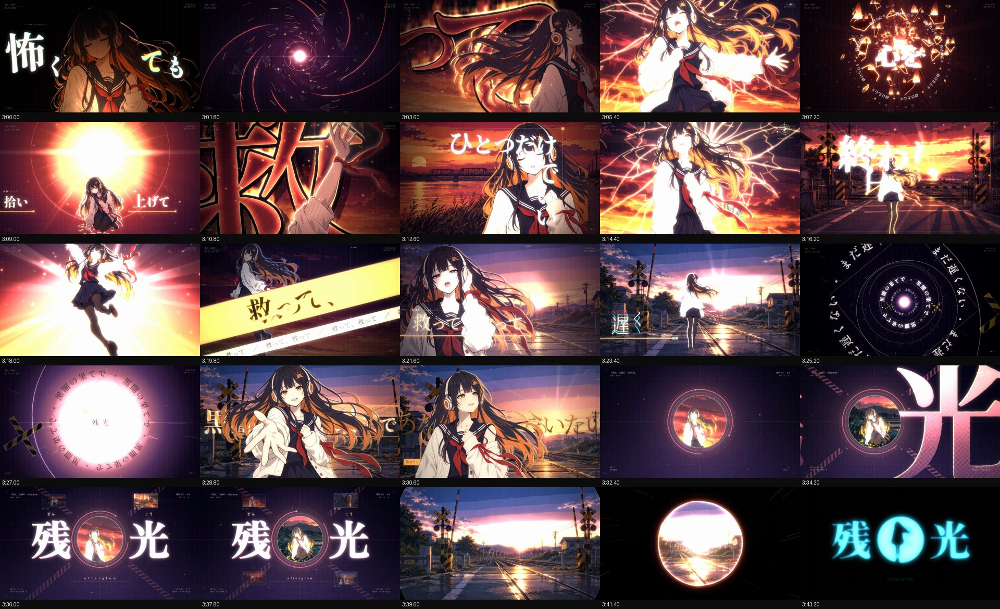

---

## 1. Thesis and logline

**Thesis: light that remains after its source is gone (persistence of vision).** The sun has set but the sky
still glows. The crossing bell keeps ringing after the train has passed. A word has been sung and its afterimage
stays on the retina. The lyric says it outright: 「終わりの中にも ひかりを残して」, "even inside the ending,
leave light behind".

**Logline.** After the sun has gone, a girl (灯 Akari) holds on to the last remaining light. The sky cracks
like glass. She falls into the night, keeps a small flame alive and gathers the pieces of her shattered heart.
At the end of the darkness she walks a road made of her own tears toward the dawn:
「黒闇の果てで あなたに会いたい」.

**Emotional arc, taken from the lyrics:** numb despair (verse 1) → a first plea (pre-chorus) → the cry "save me
from this night" (chorus) → counting losses, then *a small flame won't go out* (verse 2) → reaching for someone
(pre-chorus 2) → the turn: "I'll go, even if I'm scared" (bridge) → the same chorus words, now resolve instead of
helplessness → hope at dawn (outro).

## 2. Colour script

Five palettes ([`STYLE_RESEARCH.md`](STYLE_RESEARCH.md) §5) are applied as OKLab gradient-map LUTs in the WebGL2
post pass, so the AI-generated art is graded into one colour system.

| palette | colours | where |
|---|---|---|
| **P1 逢魔が時** magic hour | `#140B1E` `#3A1745` `#7A2350` `#C8373A` `#F0663A` `#FFA552` `#FFE3B0` | title, choruses, emotional peaks |
| **P2 残照** lingering glow | `#0B1524` `#1E3552` `#3F6284` `#D8542A` `#F4A640` `#E9D9B8` | verses: blue night vs amber |
| **P3 踏切** crossing alarm | `#0A0A0C` `#2A2F36` `#E5102E` `#FF4B3A` `#FFC21A` `#F3F1EA` | tension, alarm hits |
| **P4 蛍火** blue hour + fireflies | `#050F16` `#0C2233` `#17405A` `#2F6B6A` `#9BD86A` `#DDFF7A` | night, fireflies |
| **P5 褪色** faded photograph | `#241C1A` `#4A3B35` `#7D6A5E` `#B79C8B` `#D8C7AE` `#EFE6D6` | memories (bridge) |

**Arc:** black + one ember → P1 magic hour (verse 1a) → P2 night blue with amber (verse 1b) → P3 abyss
(pre-chorus) → P1 on fire (chorus 1) → 3D dusk → night + rain (verse 2) → P4 teal with red crossing lamps
(pre-chorus 2) → P1→P4 fireflies (chorus 2) → 3D night crossing → P5 faded memories (bridge) → black (break) →
P1 at maximum (last chorus) → **dawn** (climax) → title reprise in the dawn palette → hard cut → cyan afterimage.

**Master shapes.** The *circle* stands for light and memory: sun, ember, crossing lamp, 。, iris, firefly, the
heart's glow. All circles match-cut into each other. The *crack/shard* is the broken sky and the broken heart.
The *vermilion thread*, her wrist ribbon, is the red line through the whole film.

## 3. The character: 灯 (Akari)

An original V家-style singer, designed for this song and not based on any existing character
([`CHARACTER.md`](CHARACTER.md)). She has waist-length ink-violet hair with a sunset-orange inner colour, amber
eyes, white headphones with orange ring lights, and a setting-sun hairpin (that is the title, worn as an
accessory). Her outfit is a navy sailor blouse with a vermilion tie and an oversized cream cardigan. Her motion
prop is a long vermilion ribbon on the left wrist, which trails in the wind and becomes the "thread of tomorrow".

Three master candidates were generated and one was picked as `REF_master.png`. Every pose (about 20) was then
generated *with the master attached as a reference image*, plus a shared style block. The style block asks for
brush-pen line art with pressure, flat cel colour with one hard shadow tone, no airbrush, and a restrained dusk
palette. The poses were then chroma-keyed to RGBA.

| master candidates | pose sheet |
|---|---|
| 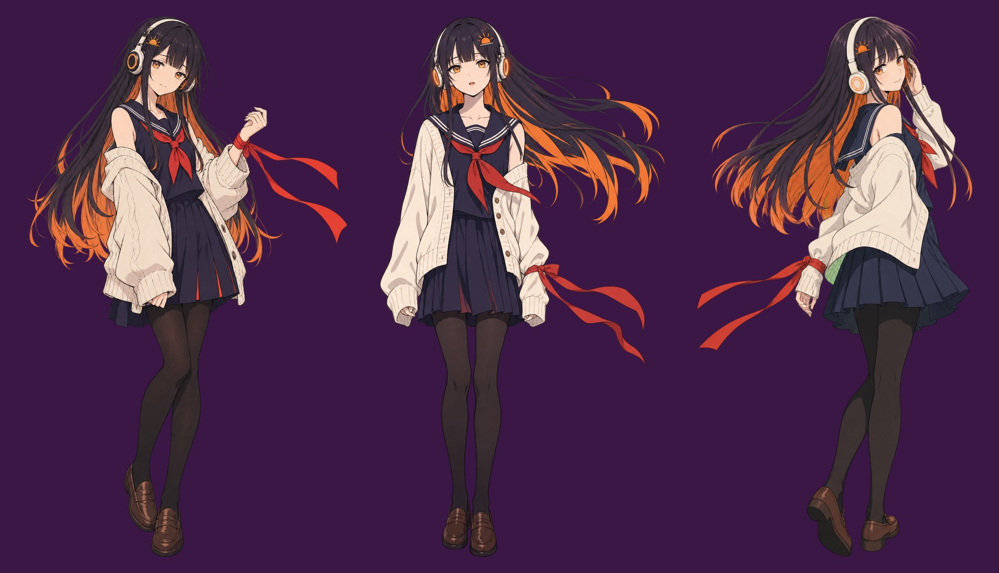 | 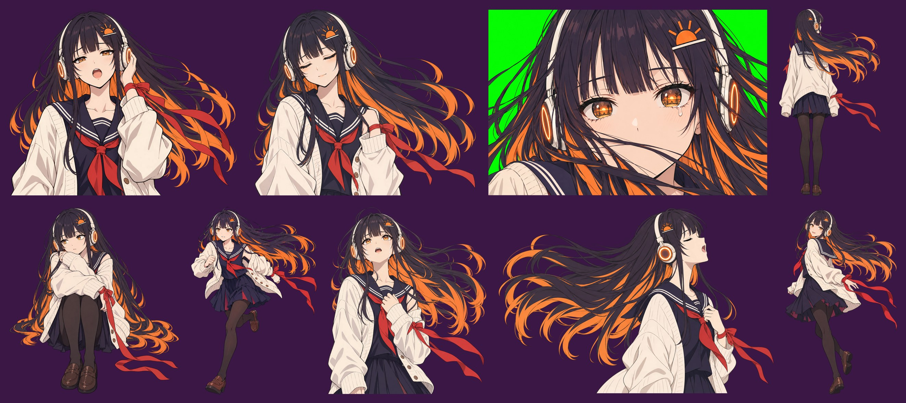 |

Locations come from the lyrics' imagery plus the colour script. There are 14 backgrounds in total, and the key
locations have true night and dawn variants rather than only re-grades:

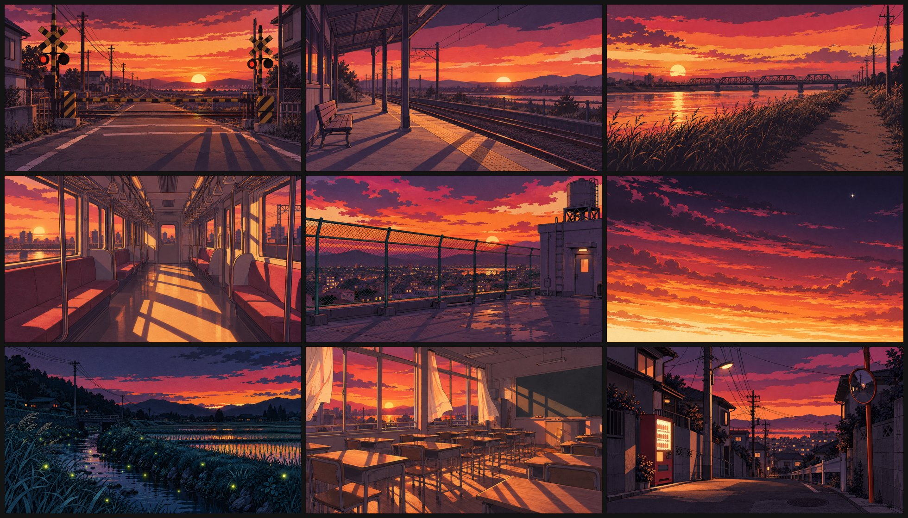
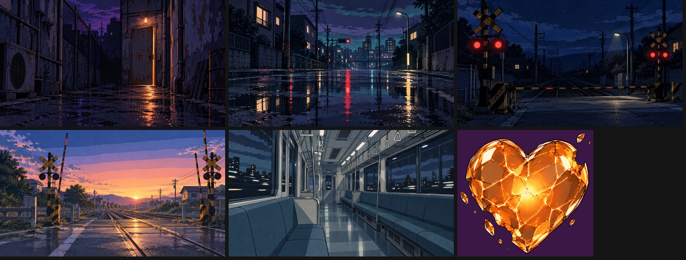

## 4. Lyric → image

Each line is *answered* with an image, not illustrated literally:

| lyric | image |
|---|---|
| ひび割れた空を見上げて | glowing cracks spread across the sky from the sun while she looks up from below |
| 名前もない影を抱いた | she hugs herself, far away, and her long shadow stretches toward the camera |
| ほどけた糸みたいな明日を | her wrist ribbon unravels into one vermilion thread across the whole frame |
| ねえ、どこまで堕ちれば / 朝に触れられるの | she falls backward through darkness; a tiny square of dawn far above; time freezes on the stop |
| 濡れた床に落ちた願いを / ひとつずつ数えていた | glowing words fall like drops into puddles; one drop per beat with a counter |
| もう何も要らない | a black frame with one small mincho line: a held silence |
| 小さな火が消えない | the flame in her hands grows, and the warm palette returns |
| 砕けた心を / 拾い上げて | the glass heart shatters in slow motion; the shards drift back into her hands |
| 絶望の形を抱きしめたまま | black ink tendrils grow around her on a white field |
| 零れた涙が道になるなら | a tear lands and spreads into a road of light toward the horizon |
| 黒闇の果てで あなたに会いたい | a tunnel of lyric rings flies toward a point of light that becomes the dawn; she reaches to the viewer |

## 5. Structure: sections → shots

The edit follows the beat analysis ([`AUDIO_MAP.md`](AUDIO_MAP.md)): ≈130.5 BPM, drifting 128.3 → 132.4,
121 bars of 4/4, and a dead stop at 3:43.54. Inside sections, cuts land on lyric onsets snapped to beats
(`nb(t)`). At section changes they land on bar starts (`B(n)`). Shot ids and times below are from the final
[`timeline.js`](timeline.js). [`STORYBOARD.md`](STORYBOARD.md) is the original plan, and review passes changed
it in places (extra shots `s52b` / `s58b`, re-ordered last-chorus cuts).

| section | time | shots | what happens |
|---|---|---|---|
| Intro (build) | 0:00–0:10.3 | s01–s02 | `ember`: one ember breathes with the vocal chops and drops to pure black on each micro-stop, then ignites into a ring on bar 4 |
| Intro riff | 0:10.3–0:17.8 | s03 | `titleRiff`: **title lockup in the sun** |
| Verse 1a | 0:17.8–0:32.7 | s04–s07 | cracked sky (P1), long shadow at the crossing, the vermilion `thread`, the dusk platform |
| Verse 1b | 0:32.7–0:47.2 | s08–s11 | rusted door, eye close-up with tear glint, cold hand, night train |
| Pre-chorus 1 | 0:47.2–0:58.8 | s12–s14 | `fall` with a time freeze on the stop, full-frame JIZURA noir 文字PV (`jz`), breathing bust in deep blue |
| Break 1 | 0:58.8–1:02.5 | s15 | `flame`: gutters on the stop, relights, zooms into white |
| Chorus 1 | 1:02.5–1:19.2 | s16–s22 | 救 `kanjiSlam`, cracked sky, **glass heart** shatter → gather, コマ割り `panels`, sinking sun leaves a ring, `ref` freeze + crack on the stop |
| Post-chorus hit | 1:19.2–1:26.6 | s23 | `seq`: **Blender A, 3D street of kanji** |
| Verse 2 | 1:26.6–1:54.7 | s24–s32 | `wetFloor` words into puddles and counted drops, feathers, the silent `typeCard`, chest glow, flame grows, `ref` melt into the falling glide |
| Pre-chorus 2 | 1:54.7–2:08.9 | s33–s36 | **train strobe** at the night crossing, sound-ring arcs, JIZURA glitch, push into her palm |
| Break 2 | 2:08.9–2:10.7 | s37 | `typeCard`: one quiet line, 「ここにいて」, on black |
| Chorus 2 | 2:10.7–2:27.2 | s38–s43 | 救 slam (night variant), `skyShatter` reveals the stars, heart shards turn into fireflies, 4 panels, a 光 formed by fireflies, VHS rewind on the stop |
| Interlude | 2:27.2–2:34.5 | s44 | `seq`: **Blender B, 3D night crossing** |
| Bridge | 2:34.5–2:56.3 | s45–s48 | `memories` (P5 polaroids burn), **ink despair**, darkened eyes and a falling tear, **road of tears** |
| Break 3 | 2:56.3–3:03.6 | s49–s51 | she runs along the road (わたしは行くよ), a flame in darkness (怖くても), every motif `converge`s into one point |
| Last chorus | 3:03.6–3:18.1 | s52–s58 | everything returns "on fire": burning 救 slam, heart burns → reborn sun, hand + 救, per-beat `burst`, sky breaking into light, sunset → white |
| Last chorus reprise | 3:18.1–3:32.7 | s58b–s63 | she leaps into an exploding sun, night→dawn `burst`, dawn crossing, lyric `tunnel`, reach, smile in the dawn: the **dawn reprise** |
| Outro riff | 3:32.7–3:43.5 | s64–s65 | `titleRiff` outro in the dawn palette with a per-beat recap montage, then the world collapses into one point |
| Tail | 3:43.5–3:46.5 | s66 | **hard cut** → `afterimage` |

## 6. Signature moments, and how they were built

| moment | time | how |
|---|---|---|
| **Title lockup in the sun** | 0:10.3 | `titleRiff` locked to the riff accents. The ember ring becomes the sun disc; monumental 残 / 光 (Zen Old Mincho Black, cropped) slam on accents over rotating arcs, measure lines, crossbuck ✕ geometry and HUD metadata; her silhouette appears inside the sun at 0:14.06; the lockup with ruby ざんこう and "afterglow" lands at 0:15.93 and leaves through an iris out of the sun. |
| **Cracked sky** | 0:17.8 · 2:12.0 · 3:15 | Procedural glowing fracture lines (`fxBack: cracks`) grow from the sun over `bg_sky`. In chorus 2, `skyShatter` lets the shards fall away to reveal a starry night. In the last chorus the cracked sky breaks into light. |
| **Glass heart** | 1:05.8 · 2:15.7 · 3:06.8 | The `heart` scene on one transparent prop: cracks, slow-motion shatter, shards drifting back into her hands (`kneel_pick`). In chorus 2 the shards become fireflies. In the last chorus they ignite and converge into a reborn sun. |
| **Train strobe** | 1:54.7 | `train`: the crossing lamps alternate on every beat while a train passes as strobing car silhouettes; each lit window shows a glimpse of her (「誰かの声が」). |
| **Ink despair** | 2:41.8 | `ink`: on 「絶望の形を」 black ink tendrils grow around her on a white field with rim light, and the lyric sits either side of her. |
| **Road of tears** | 2:49.0 | `road`: a tear falls in slow motion, lands on dark ground and spreads into a glowing line that becomes a road to the horizon. Then she runs along it, tracked by the camera with speed lines (「わたしは行くよ」). |
| **Text passing behind the character** | throughout | Characters with `front: true` are drawn on the *foreground layer*, after the text layer. Huge lyrics (救 slams, わたしは行くよ, the chorus lines) pass behind her and stay crisp, because the scene-only post effects never touch the text. |
| **3D street of kanji** | 1:19.2 | Blender A, on the post-chorus hit with no vocal: a toon dusk street flythrough past giant 3D kanji monoliths 救 光 夜 残 and power lines; the camera races toward the sun, then cranes up to the first stars. EEVEE + Shader-to-RGB + Grease Pencil Line Art ([`BLENDER_RECIPE.md`](BLENDER_RECIPE.md)), played back in sync by `seq`. |
| **3D night crossing** | 2:27.2 | Blender B: the camera orbits and rises over a night railway crossing; lamps alternate per beat, barrier arms drop on downbeats, and it cranes into the stars with the riser → white. |
| **Dawn reprise** | 3:18–3:43 | The night→dawn LUT creeps into the per-beat climax cuts. The dawn crossing and the lyric tunnel lead to the title geometry returning in the dawn palette, with a per-beat recap of the film's key frames. |
| **Cyan afterimage end card** | 3:43.54 | The music cuts dead on the downbeat of bar 122, so the film hard-cuts to black there, with no fade. The negative (cyan) afterimage of 残光 and her silhouette glows and fades over the 3-second silent tail, with the credit *Music / Lyrics / Movie：NikusonP*. |

Also note the **restraint**: long holds in verse 1, a near-empty black card for 「もう何も要らない」, and
one effect at a time outside the choruses. That restraint is why the bursts read as bursts.

| Blender A: street of kanji | Blender B: night crossing |
|---|---|
| 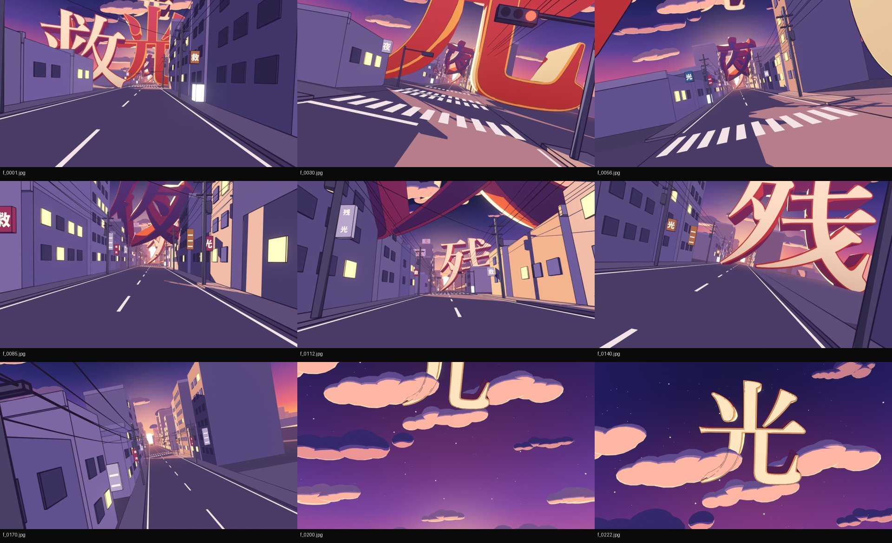 | 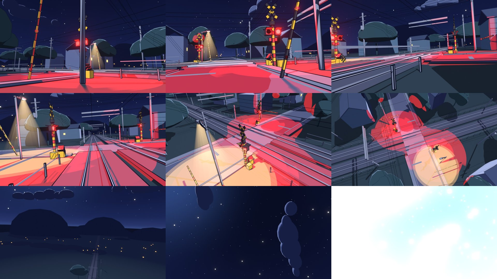 |

## 7. Typography: JIZURA plans

The lyric layer is [JIZURA 字面](https://github.com/852wa/JIZURA) (852wa, MIT) running inside the engine. The
film uses four plans built from the official LRC (`analysis/lyrics_mv.lrc`, with `/` cut breaks, `*emphasis*`
and `!` キメ lines): `main` (gold, emotional), `cf` (gold, centre-free, which keeps the middle clear for
character shots), `noir` (glitch) and `mono` (graphic, for the last chorus). Each plan is curated by deny-lists
that remove opaque cards, light-background schemes, gimmick layouts and horror moods. Some キメ lines are set by
custom scenes instead (`kanjiSlam`, `typeCard`, `tunnel`) with `lyric: 'none'`.

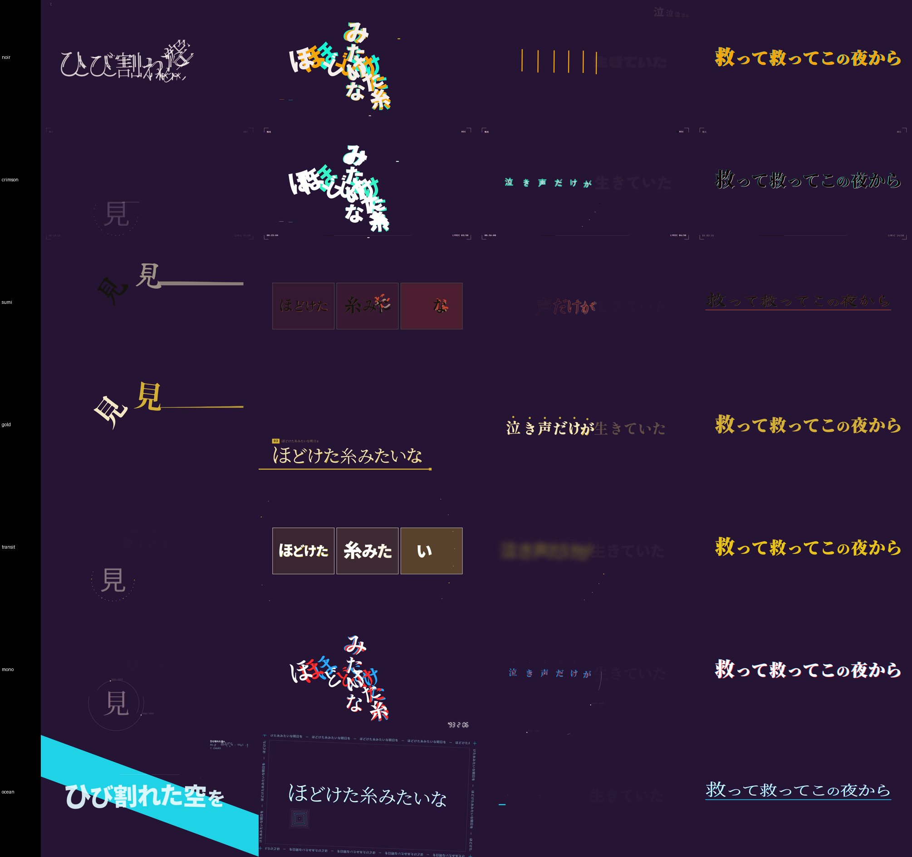

## 8. What is in this folder

| file | what it is |
|---|---|
| [`STORYBOARD.md`](STORYBOARD.md) | the treatment: logline, colour script, master shapes, bar table, the 66-row shot list, and the argument contracts of the special scenes |
| [`timeline.js`](timeline.js) | the actual edit: JIZURA plan setup and curation, the 68 shots with scene args, post params and transitions, and the custom fx helpers (long shadow, light sweep, sinking sun, firefly glyph, sound rings) |
| [`CHARACTER.md`](CHARACTER.md) | the character bible for 灯 plus the shared style block appended to every prompt |
| [`STYLE_RESEARCH.md`](STYLE_RESEARCH.md) | the visual-language research and style bible: twelve rules, concept, genre anatomy, motif bank, the five palettes, typography system, timing conventions, photosensitivity guardrails, and a 94-recipe effect cookbook |
| [`AUDIO_MAP.md`](AUDIO_MAP.md) | tempo and meter, section timeline, stops and drops, and sync candidates, generated from the analysis |
| [`LYRICS_NOTES.md`](LYRICS_NOTES.md) | how the lyric timings were made (multi-pass faster-whisper, vocal separation, forced alignment), uncertain lines, and the story/imagery reading of the lyrics |
| [`ENGINE_API.md`](ENGINE_API.md) | the scene-author contract of the engine as it was used for this film |
| [`BLENDER_RECIPE.md`](BLENDER_RECIPE.md) | the toon-3D recipe: look, line art options, passes, timings, Blender 5.1 API gotchas |
| `analysis/audio.json` | beats, downbeats, bars, sections, stops, impacts, vocal activity |
| `analysis/lyrics_mv.lrc` | official lyrics with sung-onset timings and JIZURA markup |
| `analysis/lyrics_translation.json` | per line: reading, romaji, Chinese and English translation |
| `analysis/overview.png` | the analysis plot (waveform, energy, beats, sections) |
| `prompts/*.jsonl` | the `tools/imagegen.py` job files: `jobs_master` (3 master candidates), `jobs_core` / `jobs_more` / `jobs_story` (poses), `jobs_fix` (re-takes), `bg_jobs_bg` / `bg_jobs_story` (backgrounds, night/dawn variants, the heart prop) |
| `gallery/sheet_00–05.jpg` | review contact sheets of the final 16:9 render, one frame every 1.8 s |
| `gallery/vsheet_01–02.jpg` | contact sheets of the 9:16 vertical version |
| `gallery/blender_A.jpg`, `blender_B.jpg` | frames from the two Blender sequences |
| `gallery/jizura_styles.jpg`, `style_palettes.png` | the JIZURA style probe and the palette contact sheet |
| `gallery/_masters.jpg`, `_core.jpg`, `_more.jpg`, `_story_a.jpg`, `_fix.jpg`, `_bgs.jpg`, `_story.jpg` | contact sheets of the generated assets |

Paths inside these notes (`docs/…`, `tools/…`, `engine/…`, `assets/…`) refer to the original project. That
layout is the same as the [template](../../skills/vocaloid-style-mv/template/). Where `STORYBOARD.md` quotes a
lyric differently from `analysis/lyrics_mv.lrc`, the LRC holds the official text.

## 9. Gallery

The final 16:9 render, one frame every 1.8 s:

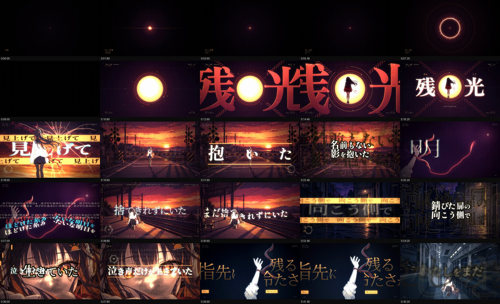
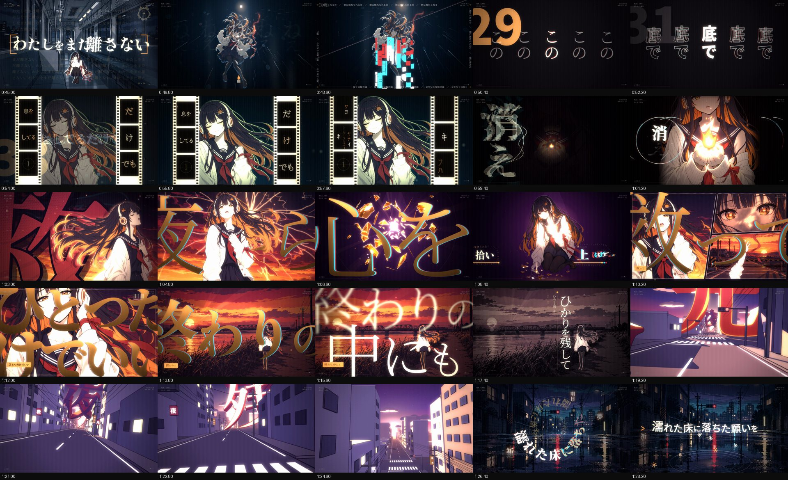
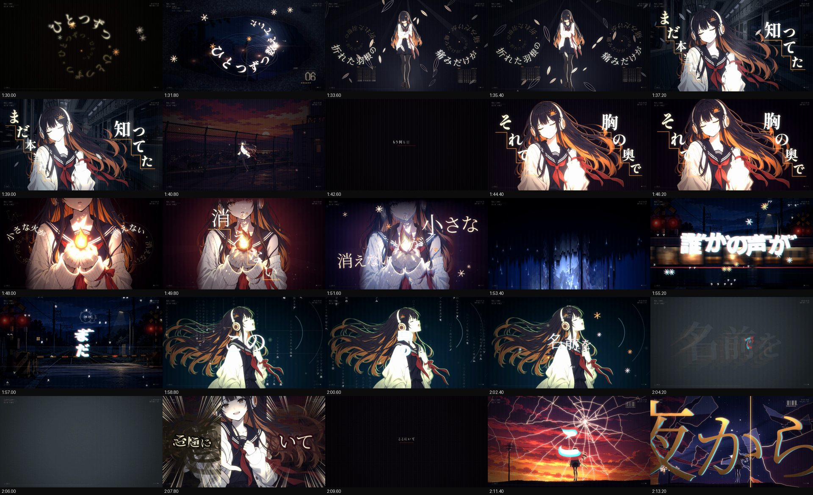
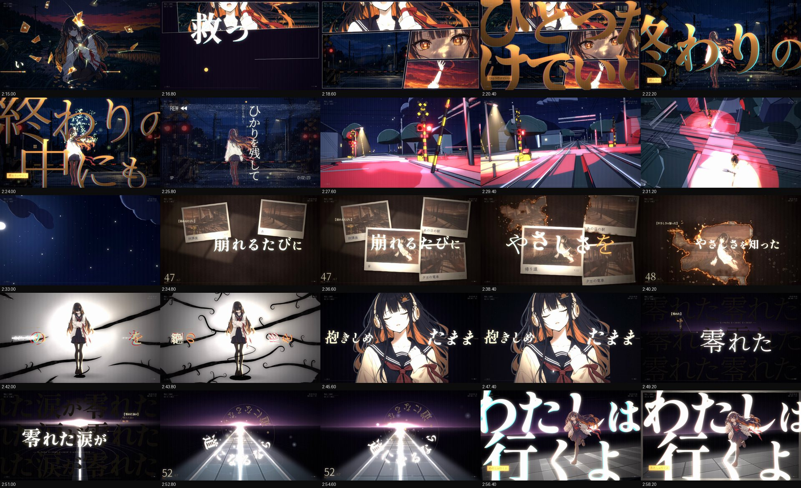

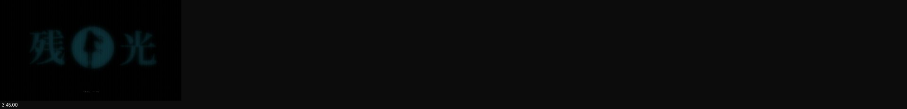

The 9:16 vertical version. JIZURA re-typesets the lyrics natively in its centre-free mode around a picture band:

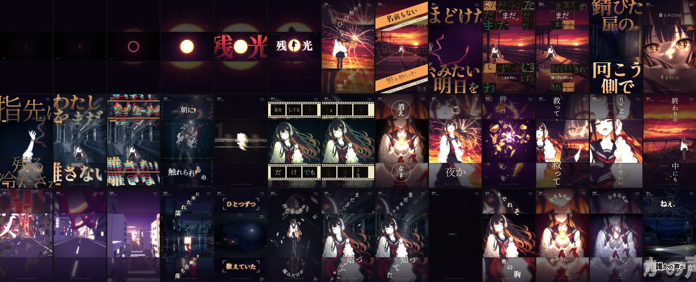
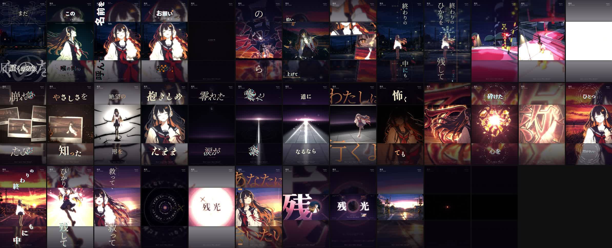

More assets:

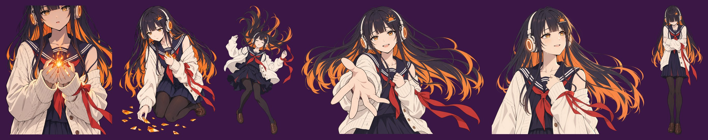
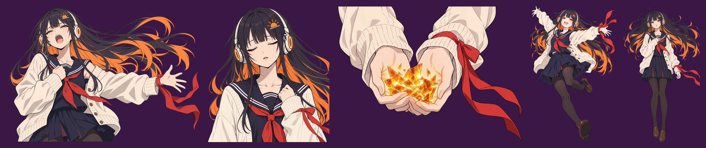
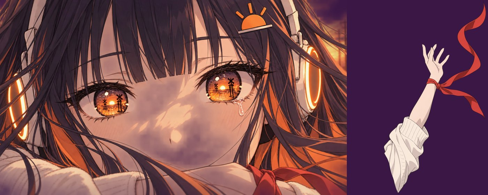
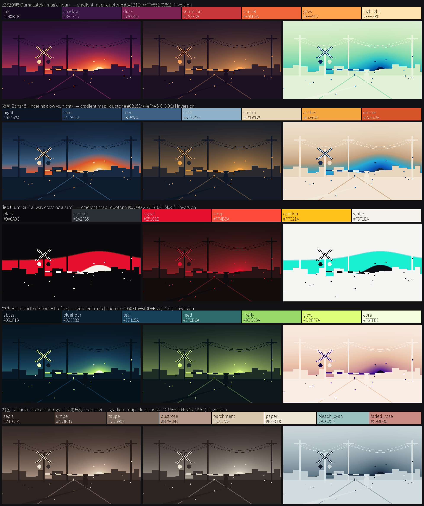

---

「残光」: Music / Lyrics / Movie：**NikusonP**. The song, lyrics, character and MV frames are NikusonP's
work and are shown here as a case study. The song audio and full-resolution artwork are not included.
